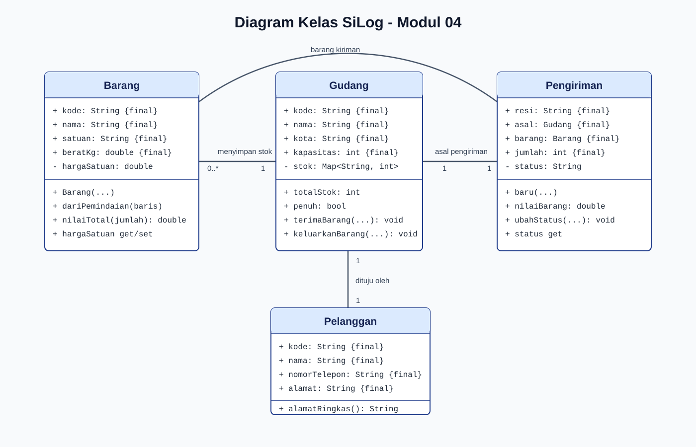

# Jurnal Praktikum Pemrograman IV - Modul 04

## 1. Identitas

| Keterangan | Isi |
| --- | --- |
| Nama | Richard Firmansyah |
| NIM | 714240047 |
| Kelas | 3C-D4-TI |
| Modul | Modul 04 - Pemrograman Berorientasi Objek Dasar |
| Tanggal praktikum | 14 Oktober 2026 |

## 2. Tujuan Praktikum

1. Memodelkan proses logistik ke dalam kelas `Barang`, `Gudang`,
   `Pengiriman`, dan `Pelanggan`.
2. Menggunakan konstruktor biasa, konstruktor bernama, getter, setter,
   atribut `final`, dan atribut privat pada Dart.
3. Memastikan perubahan stok serta status pengiriman divalidasi oleh metode.

## 3. Alat dan Bahan

| Alat | Versi/Keterangan |
| --- | --- |
| macOS | 15.8 |
| Flutter SDK | 3.47.4 stable |
| Dart SDK | 3.13.3 stable |
| Visual Studio Code | Editor dengan ekstensi Flutter dan Dart |
| GitHub | https://github.com/copetpasarsenin/silog-714240047 |

## 4. Langkah Kerja

1. Membuat cabang `praktikum/modul-04` dari proyek `silog_app`.
2. Membuat direktori `lib/model`.
3. Membuat kelas `Barang`, `Gudang`, dan `Pengiriman` sesuai instruksi modul.
4. Menambahkan kelas `Pelanggan` untuk tugas praktikum.
5. Membuat `latihan/modul04_uji.dart` untuk menjalankan skenario logistik.
6. Membuat pengujian otomatis pada `test/modul04_models_test.dart`.
7. Menjalankan `dart format`, `flutter analyze`, `dart run`, dan `flutter test`.

## 5. Rancangan Kelas

Diagram kelas akhir:



| Kelas | Entitas nyata | Atribut utama | Perilaku utama |
| --- | --- | --- | --- |
| `Barang` | Barang yang disimpan/dikirim | kode, nama, satuan, berat, harga | Membaca/mengubah harga tervalidasi dan menghitung nilai barang. |
| `Gudang` | Lokasi penyimpanan | kode, nama, kota, kapasitas, stok | Menerima serta mengeluarkan barang dengan validasi kapasitas dan stok. |
| `Pengiriman` | Pengiriman antar kota | resi, asal, tujuan, barang, jumlah, tanggal, status | Menghitung nilai kiriman dan memajukan status secara berurutan. |
| `Pelanggan` | Penerima kiriman | kode, nama, telepon, alamat | Menyajikan alamat singkat untuk tampilan ringkas. |

## 6. Kode Program dan Penjelasan

| Berkas | Isi |
| --- | --- |
| `lib/model/barang.dart` | Kelas barang, setter harga non-negatif, konstruktor `Barang.dariPemindaian`, dan `nilaiTotal`. |
| `lib/model/gudang.dart` | Penyimpanan stok privat `_stok`, getter stok tidak dapat diubah, serta operasi stok tervalidasi. |
| `lib/model/pengiriman.dart` | Kelas pengiriman dengan konstruktor `Pengiriman.baru`, status privat, dan validasi urutan status. |
| `lib/model/pelanggan.dart` | Tugas praktikum: data pelanggan dan `alamatRingkas()` maksimal 40 karakter. |
| `latihan/modul04_uji.dart` | Skenario pembentukan objek, perubahan stok, perubahan status, dan operasi yang ditolak. |
| `test/modul04_models_test.dart` | Enam pengujian unit untuk perilaku model serta batasan validasi. |

Atribut identitas yang tidak boleh diganti setelah objek dibuat menggunakan
`final`, misalnya `kode`, `nama`, `resi`, `asal`, dan `jumlah`. Nilai yang
harus dikendalikan memakai atribut privat: `_hargaSatuan`, `_stok`, dan
`_status`. Pemisahan ini mencegah data logistik berubah tanpa validasi.

## 7. Hasil Eksekusi dan Analisis

Perintah yang dijalankan:

```text
dart format lib/model latihan/modul04_uji.dart test/modul04_models_test.dart test/widget_test.dart
flutter analyze
dart run latihan/modul04_uji.dart
flutter test
```

Hasil `flutter analyze`: `No issues found!`.

Hasil `dart run latihan/modul04_uji.dart`:

```text
GD-BDG-Gudang Utama Bandung (Bandung), stok 420/500
Rincian stok: {B-1024: 120, B-2048: 300}
Alamat pelanggan: Jalan Raya Logistik Nomor 123 Kecamat...
SLG-2026-0007 | Sepatu Lari Pria x10 | Bandung -> Surabaya | Richard Firmansyah | Menunggu Pickup
Nilai barang: Rp4500000
Status terbaru: Dalam Perjalanan
Ditolak: Status tidak dapat mundur dari Dalam Perjalanan ke Draft
Ditolak: Stok B-1024 hanya 110, tidak dapat mengeluarkan 9999
```

Output membuktikan stok awal 120 sepatu dan 300 kaos menjadi 420 unit.
Setelah 10 sepatu dikirim, stok sepatu tersisa 110. Sistem juga menolak
status yang mundur dan pengeluaran yang melebihi stok tersedia.

Hasil `flutter test`: 7 pengujian lulus, terdiri dari 6 pengujian model
Modul 04 dan 1 pengujian widget beranda yang telah disesuaikan dengan
aplikasi saat ini.

## 8. Jawaban Tugas Praktikum

### 8.1 Kelas Pelanggan

Kelas `Pelanggan` telah ditambahkan pada `lib/model/pelanggan.dart` dengan
atribut `kode`, `nama`, `nomorTelepon`, dan `alamat`. Metode
`alamatRingkas()` mengembalikan alamat lengkap bila panjangnya maksimal 40
karakter. Jika lebih panjang, metode memotong alamat menjadi 37 karakter
dan menambahkan `...`, sehingga hasil tidak lebih dari 40 karakter.

### 8.2 Percobaan Akses Langsung `_stok`

Percobaan berikut dijalankan dari berkas di luar library `gudang.dart`:

```dart
final stokInternal = gudang._stok;
```

Hasil kompilasi:

```text
Error: The getter '_stok' isn't defined for the type 'Gudang'.
```

Garis bawah pada `_stok` menjadikan atribut tersebut privat pada library
Dart. Kode luar tidak dapat mengubah stok secara langsung. Perubahan hanya
melalui `terimaBarang()` dan `keluarkanBarang()` agar jumlah positif,
kapasitas gudang, dan stok tersedia selalu diperiksa. Ini adalah penerapan
enkapsulasi karena keadaan internal objek tidak dibuka tanpa kontrol.

## 9. Tabel Skenario Uji

| ID | Skenario | Hasil yang diperoleh | Status |
| --- | --- | --- | --- |
| S01 | Membuat `Barang.dariPemindaian` | Kode, nama, satuan, dan nilai total benar. | Lulus |
| S02 | Mengatur harga negatif | `ArgumentError` dilempar. | Lulus |
| S03 | Gudang menerima lalu mengeluarkan barang | Stok berubah dari 120 menjadi 110; getter stok tidak dapat diubah. | Lulus |
| S04 | Stok melebihi kapasitas/pengeluaran berlebih | `StateError` dilempar. | Lulus |
| S05 | Membuat `Pengiriman.baru` dan memajukan status | Status awal `Menunggu Pickup`, lalu `Dalam Perjalanan`. | Lulus |
| S06 | Status mundur/tidak dikenal | `StateError` dan `ArgumentError` dilempar. | Lulus |
| S07 | Alamat pelanggan panjang | Hasil ringkas tidak lebih dari 40 karakter. | Lulus |
| S08 | Mengakses `_stok` dari luar library | Kompilator menolak akses privat. | Lulus |

## 10. Kesimpulan dan Kendala

Kelas Barang, Gudang, Pengiriman, dan Pelanggan berhasil memetakan entitas
proses logistik. Konstruktor bernama memudahkan pembentukan objek dari data
pemindaian serta pendaftaran pengiriman baru. Atribut `final` menjaga
identitas objek, sedangkan atribut privat dan metode tervalidasi menjaga
stok, harga, serta status tetap konsisten. Tidak ada kendala pada analisis
kode maupun pengujian otomatis.

## 11. Repositori dan Riwayat Commit

- Repositori: https://github.com/copetpasarsenin/silog-714240047
- Cabang: `praktikum/modul-04`
- Commit Modul 04: `7bdd363 modul-04: model logistik berorientasi objek`.

## 12. Bukti Visual yang Masih Harus Ditambahkan Sebelum Pengumpulan

1. Tangkapan layar editor yang menampilkan setiap berkas model dan nama/NIM.
2. Tangkapan layar terminal saat `dart run latihan/modul04_uji.dart`.
3. Tangkapan layar terminal saat `flutter analyze` dan `flutter test` lulus.
4. Tangkapan layar browser GitHub yang menampilkan branch dan riwayat commit.
