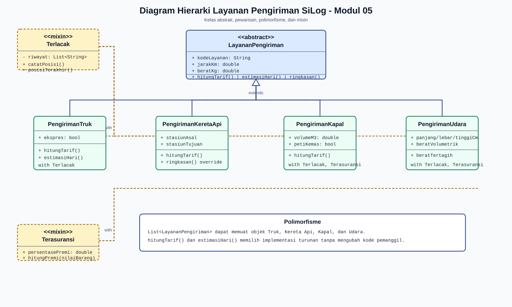

# Jurnal Praktikum Pemrograman IV - Modul 05

## 1. Identitas

| Keterangan | Isi |
| --- | --- |
| Nama | Richard Firmansyah |
| NIM | 714240047 |
| Kelas | 3C-D4-TI |
| Modul | Modul 05 - Pemrograman Berorientasi Objek Lanjut |
| Tanggal praktikum | 21 Oktober 2026 |

## 2. Tujuan Praktikum

1. Menerapkan pewarisan pada beberapa moda transportasi pengiriman.
2. Menerapkan method overriding untuk tarif, estimasi hari, dan ringkasan layanan.
3. Menggunakan kelas abstrak sebagai kontrak layanan pengiriman.
4. Membuktikan polimorfisme melalui `List<LayananPengiriman>`.
5. Menggunakan mixin `Terlacak` dan `Terasuransi` sesuai kemampuan objek.

## 3. Alat dan Bahan

| Alat | Versi/Keterangan |
| --- | --- |
| macOS | 27.0.1 |
| Flutter SDK | 3.47.4 stable |
| Dart SDK | 3.13.3 stable |
| Visual Studio Code | Editor dengan ekstensi Flutter dan Dart |
| GitHub | https://github.com/copetpasarsenin/silog-714240047 |

## 4. Langkah Kerja

1. Membuat branch `praktikum/modul-05` dari proyek `silog_app`.
2. Membuat direktori `lib/layanan`.
3. Membuat kelas abstrak `LayananPengiriman`, mixin `Terlacak`, dan mixin `Terasuransi` pada `lib/layanan/layanan_pengiriman.dart`.
4. Membuat turunan `PengirimanTruk`, `PengirimanKeretaApi`, `PengirimanKapal`, dan `PengirimanUdara` pada `lib/layanan/moda.dart`.
5. Membuat program polimorfisme `latihan/modul05_uji.dart`.
6. Membuat test perilaku pada `test/modul05_layanan_test.dart` sebelum implementasi, menjalankannya dalam kondisi gagal karena berkas layanan belum ada, lalu mengimplementasikan kode minimal hingga lulus.
7. Menjalankan `dart format`, `flutter analyze`, `flutter test`, dan `dart run latihan/modul05_uji.dart`.
8. Membuat diagram kelas akhir pada `diagram_kelas_modul05.svg`.

## 5. Rancangan Hierarki Kelas



`LayananPengiriman` adalah kelas abstrak dengan atribut bersama `kodeLayanan`, `jarakKm`, dan `beratKg`. Kelas ini menetapkan kontrak `hitungTarif()` dan `estimasiHari()`, sedangkan `ringkasan()` diwariskan oleh semua turunan.

| Kelas | Pewarisan/mixin | Perilaku khusus |
| --- | --- | --- |
| `PengirimanTruk` | `extends LayananPengiriman with Terlacak` | Tarif berdasarkan kilometer dan berat; layanan ekspres dikali 1,5. |
| `PengirimanKeretaApi` | `extends LayananPengiriman with Terlacak` | Tarif berdasarkan kilometer x berat ditambah bongkar-muat; `ringkasan()` di-override dengan stasiun. |
| `PengirimanKapal` | `extends LayananPengiriman with Terlacak, Terasuransi` | Tarif berdasarkan volume dan biaya pelabuhan; memiliki premi asuransi. |
| `PengirimanUdara` | `extends LayananPengiriman with Terlacak, Terasuransi` | Tarif menggunakan berat tertagih terbesar antara aktual dan volumetrik, ditambah biaya bandara. |

Pewarisan dipakai karena setiap moda adalah sebuah layanan pengiriman. Mixin dipakai untuk kemampuan tambahan lintas moda: `Terlacak` menyediakan riwayat posisi, sedangkan `Terasuransi` hanya dipasang pada moda kapal dan udara.

## 6. Kode Program dan Penjelasan

| Berkas | Isi |
| --- | --- |
| `lib/layanan/layanan_pengiriman.dart` | Mixin `Terlacak`, mixin `Terasuransi`, dan kelas abstrak `LayananPengiriman`. |
| `lib/layanan/moda.dart` | Empat kelas moda pengiriman dengan implementasi tarif dan estimasi yang berbeda. |
| `latihan/modul05_uji.dart` | Daftar bertipe induk, perbandingan tarif, pelacakan truk, dan demonstrasi asuransi. |
| `test/modul05_layanan_test.dart` | Empat test: tarif/estimasi, berat volumetrik udara, batas asuransi, dan riwayat terlacak. |

Rumus utama yang digunakan:

```text
Truk        = (jarakKm x 4.500) + (beratKg x 1.200)
Truk ekspres = tarif truk x 1,5
Kereta api  = (jarakKm x beratKg x 95 / 100) + 250.000
Kapal       = (volumeM3 x 850.000) + 1.750.000
Udara       = (max(beratAktual, beratVolumetrik) x 75.000) + 300.000
beratVolumetrik = panjangCm x lebarCm x tinggiCm / 6.000
```

## 7. Hasil Eksekusi dan Analisis

Perintah yang dijalankan:

```text
dart format lib/layanan latihan/modul05_uji.dart test/modul05_layanan_test.dart
flutter analyze
flutter test
dart run latihan/modul05_uji.dart
```

Hasil `flutter analyze`: `No issues found!`.

Hasil `flutter test`: seluruh 11 test proyek lulus, termasuk 4 test khusus Modul 05.

Hasil `dart run latihan/modul05_uji.dart`:

```text
=== Perbandingan Layanan Pengiriman ===
TRK-REG | 780 km | 1200.0 kg | Rp4950000 | 2 hari
TRK-EXP | 780 km | 1200.0 kg | Rp7425000 | 1 hari
KA-CARGO | 780 km | 1200.0 kg | Rp1139200 | 3 hari | Kiaracondong-Pasar Turi
KPL-PETI | 1450 km | 1200.0 kg | Rp8975000 | 8 hari
UDR-CARGO | 950 km | 12.4 kg | Rp3675000 | 2 hari

Layanan termurah: KA-CARGO
Layanan tercepat: TRK-EXP
Premi kapal: Rp10000
Premi udara: Rp15000
PengirimanTruk tidak memiliki metode hitungPremi.
```

Tarif berbeda karena setiap kelas menjalankan rumus `hitungTarif()` miliknya sendiri. Kereta api paling murah pada data uji karena rumusnya memakai faktor `95/100` per kilometer-kilogram dan biaya tetap Rp250.000. Kapal paling mahal karena volume 8,5 m3 dikalikan Rp850.000 dan biaya pelabuhan. Truk ekspres tercepat karena estimasinya membagi estimasi reguler menjadi dua. Moda udara menggunakan berat tertagih 45 kg karena berat volumetrik lebih besar daripada berat aktual 12,4 kg.

Polimorfisme terbukti karena daftar dideklarasikan sebagai `List<LayananPengiriman>`, tetapi satu perulangan dapat memanggil `ringkasan()`, `hitungTarif()`, dan `estimasiHari()` pada objek yang sebenarnya bertipe truk, kereta api, kapal, maupun udara. Penambahan objek `PengirimanUdara` hanya menambah satu elemen daftar; perulangan, pengurutan, serta pencarian layanan termurah dan tercepat tidak diubah.

## 8. Jawaban Tugas Praktikum

### 8.1 Mixin Terasuransi

Mixin `Terasuransi` menyediakan atribut `persentasePremi` dan metode `hitungPremi(double nilaiBarang)`. Metode menolak nilai barang negatif dengan `ArgumentError`. Premi kapal memakai persentase default 0,5%, sedangkan udara memakai 0,75%.

### 8.2 Pemasangan Terasuransi

`Terasuransi` dipasang hanya pada `PengirimanKapal` dan `PengirimanUdara`:

```dart
class PengirimanKapal extends LayananPengiriman with Terlacak, Terasuransi
class PengirimanUdara extends LayananPengiriman with Terlacak, Terasuransi
```

Percobaan memanggil `truk.hitungPremi(1000)` gagal dikompilasi dengan pesan berikut:

```text
Error: The method 'hitungPremi' isn't defined for the type 'PengirimanTruk'.
```

Pesan tersebut membuktikan `PengirimanTruk` tidak memiliki metode asuransi karena tidak memakai mixin `Terasuransi`.

### 8.3 Kelas Abstrak

Percobaan membuat objek `LayananPengiriman(...)` secara langsung menghasilkan:

```text
Error: The class 'LayananPengiriman' is abstract and can't be instantiated.
```

Kelas abstrak tidak dapat dibentuk sebagai objek. Kelas tersebut menjadi kerangka kontrak agar setiap moda pengiriman menyediakan `hitungTarif()` dan `estimasiHari()`, tetapi cara perhitungannya tetap ditentukan oleh setiap kelas turunan.

## 9. Tabel Skenario Uji

| ID | Skenario | Hasil | Status |
| --- | --- | --- | --- |
| S01 | Tarif dan estimasi empat moda | Nilai tarif, hari, dan override ringkasan kereta sesuai rumus. | Lulus |
| S02 | Berat volumetrik udara | 90 x 60 x 50 / 6000 menghasilkan 45 kg sebagai berat tertagih. | Lulus |
| S03 | Batas mixin asuransi | Kapal dan udara bertipe `Terasuransi`; truk bukan. | Lulus |
| S04 | Riwayat pelacakan | Posisi tercatat dan getter riwayat tidak dapat diubah. | Lulus |
| S05 | Instansiasi kelas abstrak | Kompilator menolak objek `LayananPengiriman`. | Lulus |
| S06 | Akses premi pada truk | Kompilator menolak `hitungPremi()` pada `PengirimanTruk`. | Lulus |
| S07 | Analisis statis | `flutter analyze` menghasilkan `No issues found!`. | Lulus |
| S08 | Semua regression test | `flutter test` menghasilkan `All tests passed!`. | Lulus |

## 10. Kesimpulan dan Kendala

Hierarki layanan pengiriman berhasil menerapkan abstraksi, pewarisan, overriding, polimorfisme, dan mixin. Kode bersama berada pada `LayananPengiriman`, sedangkan rumus setiap moda terisolasi pada turunan masing-masing. Mixin membatasi kemampuan pelacakan dan asuransi tanpa memaksakan pewarisan berganda. Tidak ada kendala pada formatter, analisis statis, maupun test otomatis.

## 11. Repositori dan Riwayat Commit

- Repositori: https://github.com/copetpasarsenin/silog-714240047
- Cabang: `praktikum/modul-05`
- Commit Modul 05: dibuat setelah jurnal dan bukti visual final diverifikasi.

## 12. Lampiran Bukti Visual

Berkas bukti otomatis yang telah tersedia:

- `diagram_kelas_modul05.svg`: diagram kelas akhir.
- `bukti_visual_modul05/01_diagram_kelas.png`: pratinjau diagram.
- `bukti_output_modul05.txt`: hasil eksekusi program.
- `bukti_analisis_modul05.txt`: hasil `flutter analyze`.
- `bukti_test_modul05.txt`: hasil `flutter test`.
- `bukti_error_abstrak_modul05.txt`: bukti kelas abstrak tidak dapat diinstansiasi.
- `bukti_error_asuransi_modul05.txt`: bukti truk tidak memiliki `hitungPremi()`.

Tangkapan layar manual yang masih perlu dibuat sebelum unggah LMS, karena instruksi modul mewajibkan jendela editor/terminal secara utuh dan identitas praktikan terlihat:

1. Branch `praktikum/modul-05` pada GitHub.
2. `layanan_pengiriman.dart` dan `moda.dart` di editor, dengan nama Richard Firmansyah dan NIM 714240047 terlihat.
3. Output `dart run latihan/modul05_uji.dart`.
4. `flutter analyze` dan `flutter test`.
5. Diagram kelas final.
6. Riwayat commit Modul 05 di GitHub.
