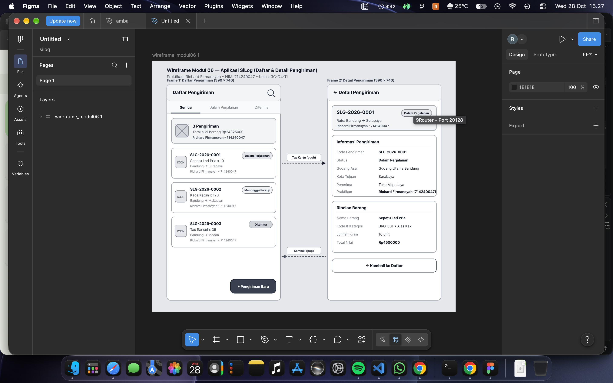
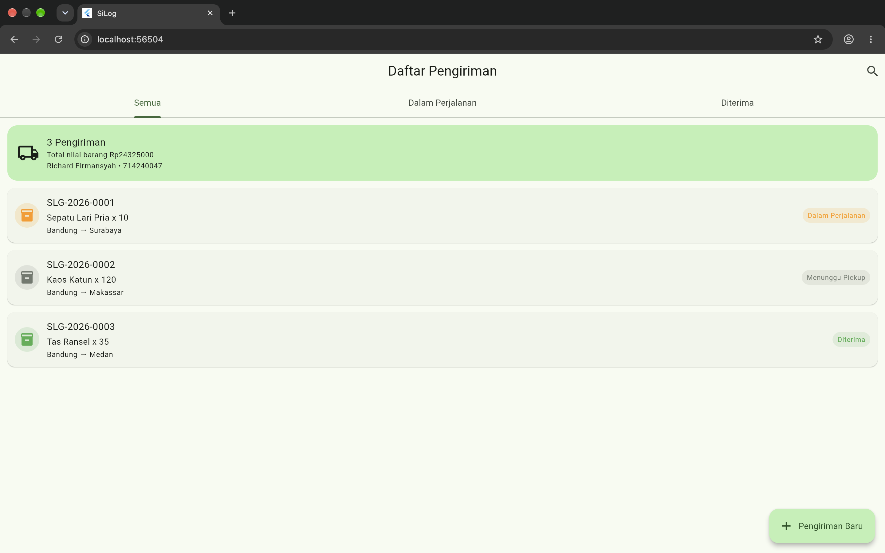
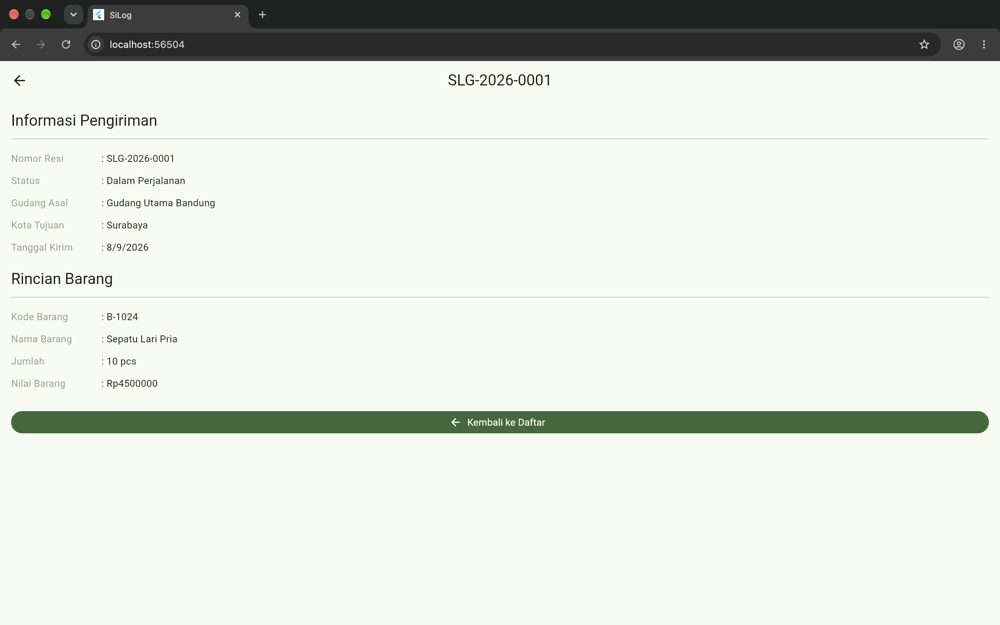
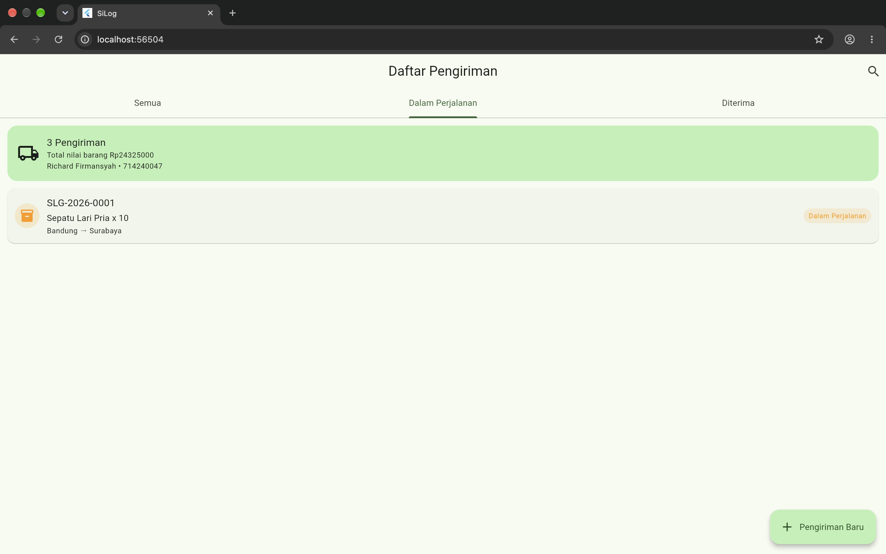
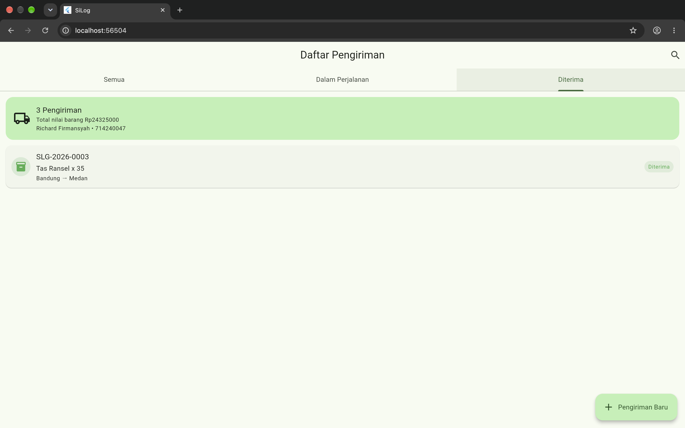
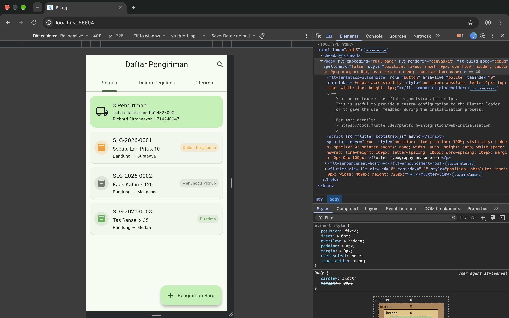
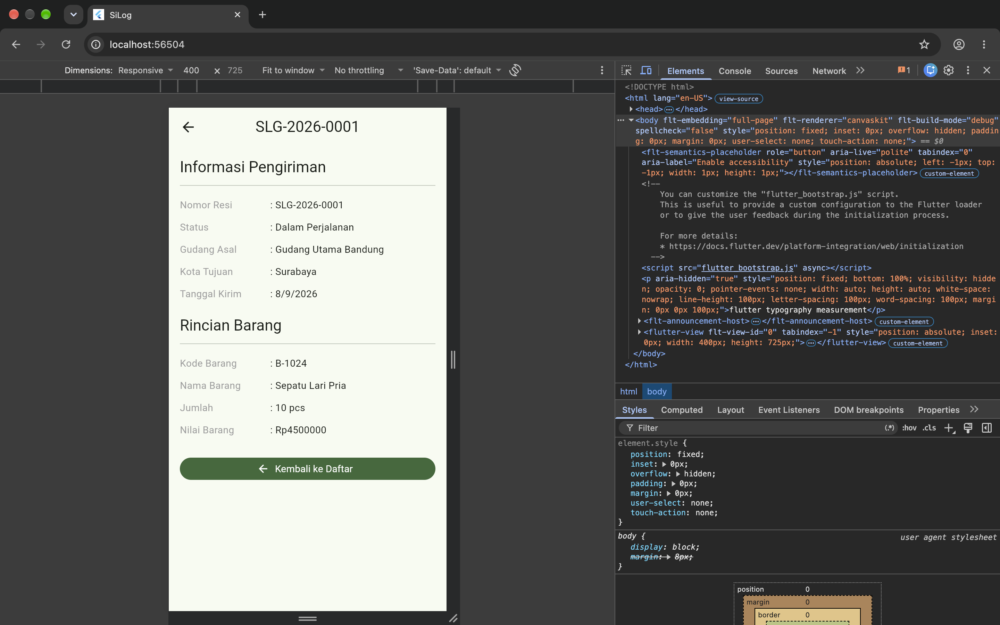
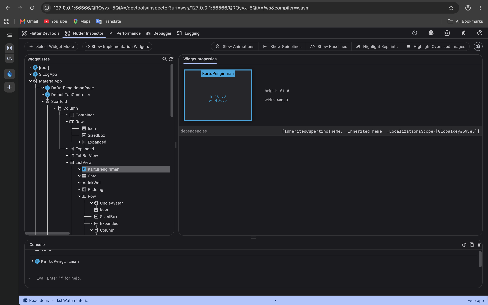

# Jurnal Praktikum Pemrograman IV - Modul 06

## 1. Identitas

| Keterangan | Isi |
| --- | --- |
| Nama | Richard Firmansyah |
| NIM | 714240047 |
| Kelas | 3C-D4-TI |
| Modul | Modul 06 - Pembangunan Antarmuka Berbasis Widget |
| Tanggal praktikum | 28 Oktober 2026 |

## 2. Tujuan Praktikum

1. Membangun layar daftar dan detail pengiriman berbasis widget Flutter.
2. Menerapkan `Row`, `Column`, `Expanded`, `Container`, `Card`, dan `ListView.builder`.
3. Menerapkan navigasi dari daftar menuju detail dan kembali ke daftar.
4. Menerapkan tema aplikasi melalui `ThemeData` dan `ColorScheme.fromSeed`.
5. Menambahkan filter tab serta ringkasan jumlah dan nilai pengiriman.

## 3. Alat dan Bahan

| Alat | Versi/Keterangan |
| --- | --- |
| macOS | 27.2 |
| Flutter SDK | 3.47.4 stable |
| Dart SDK | 3.13.3 |
| Google Chrome | 156.0.8078.48 |
| Figma Desktop | Wireframe 2 layar (`Daftar Pengiriman` & `Detail Pengiriman`) |
| GitHub | https://github.com/copetpasarsenin/silog-714240047 |

## 4. Langkah Kerja

1. Membuat branch `praktikum/modul-06` dari branch `praktikum/modul-05`.
2. Merancang wireframe 2 layar (`Daftar Pengiriman` dan `Detail Pengiriman`) di Figma dengan warna abu-abu.
3. Membuat `lib/data/data_contoh.dart` berisi tiga objek `Pengiriman`.
4. Membuat widget reusable `KartuPengiriman` pada `lib/widget/kartu_pengiriman.dart`.
5. Membuat `DaftarPengirimanPage` dengan `DefaultTabController`, `TabBar`, `TabBarView`, ringkasan, serta `ListView.builder`.
6. Membuat `DetailPengirimanPage` dengan `SingleChildScrollView` dan tombol kembali.
7. Mengganti halaman awal aplikasi pada `lib/main.dart` menjadi `DaftarPengirimanPage` serta menetapkan tema hijau Material 3.
8. Menulis widget test terlebih dahulu, lalu menjalankan formatter, analisis statis, seluruh test, build web release, serta pemeriksaan tampilan di Chrome (lebar penuh, 400 px, dan Flutter Widget Inspector).

## 5. Struktur Proyek dan Kode Sumber

### 5.1 Struktur Direktori `lib/` dan `test/`

```text
silog_app/
├── lib/
│   ├── data/
│   │   └── data_contoh.dart
│   ├── model/
│   │   ├── barang.dart
│   │   ├── gudang.dart
│   │   ├── pelanggan.dart
│   │   └── pengiriman.dart
│   ├── tampilan/
│   │   ├── daftar_pengiriman_page.dart
│   │   └── detail_pengiriman_page.dart
│   ├── widget/
│   │   └── kartu_pengiriman.dart
│   └── main.dart
└── test/
    └── widget_test.dart
```

| Berkas | Tanggung jawab |
| --- | --- |
| `lib/data/data_contoh.dart` | Data gudang, pelanggan, barang, dan tiga pengiriman contoh. |
| `lib/widget/kartu_pengiriman.dart` | Kartu reusable untuk satu pengiriman dan status berwarna. |
| `lib/tampilan/daftar_pengiriman_page.dart` | Ringkasan, filter tiga tab, daftar pengiriman, dan navigasi. |
| `lib/tampilan/detail_pengiriman_page.dart` | Informasi lengkap pengiriman yang dapat digulir. |
| `lib/main.dart` | `MaterialApp`, tema global, dan halaman awal. |
| `test/widget_test.dart` | Verifikasi daftar, filter tab, navigasi detail, dan kembali. |

### 5.2 Kode `lib/data/data_contoh.dart`

```dart
import '../model/barang.dart';
import '../model/gudang.dart';
import '../model/pelanggan.dart';
import '../model/pengiriman.dart';

final gudangBandung = Gudang(
  kode: 'GD-BDG',
  nama: 'Gudang Utama Bandung',
  kota: 'Bandung',
);

final pelangganContoh = Pelanggan(
  kode: 'PLG-001',
  nama: 'Toko Nusantara',
  nomorTelepon: '081234567890',
  alamat: 'Jl. Asia Afrika No. 12, Bandung',
);

final List<Pengiriman> dataPengiriman = [
  Pengiriman(
    resi: 'SLG-2026-0001',
    asal: gudangBandung,
    kotaTujuan: 'Surabaya',
    barang: Barang(
      kode: 'B-1024',
      nama: 'Sepatu Lari Pria',
      hargaSatuan: 450000,
    ),
    jumlah: 10,
    tanggalKirim: DateTime(2026, 9, 8),
    pelanggan: pelangganContoh,
    status: 'Dalam Perjalanan',
  ),
  Pengiriman(
    resi: 'SLG-2026-0002',
    asal: gudangBandung,
    kotaTujuan: 'Makassar',
    barang: Barang(kode: 'B-2048', nama: 'Kaos Katun', hargaSatuan: 85000),
    jumlah: 120,
    tanggalKirim: DateTime(2026, 9, 9),
    pelanggan: pelangganContoh,
    status: 'Menunggu Pickup',
  ),
  Pengiriman(
    resi: 'SLG-2026-0003',
    asal: gudangBandung,
    kotaTujuan: 'Medan',
    barang: Barang(kode: 'B-3072', nama: 'Tas Ransel', hargaSatuan: 275000),
    jumlah: 35,
    tanggalKirim: DateTime(2026, 9, 10),
    pelanggan: pelangganContoh,
    status: 'Diterima',
  ),
];
```

### 5.3 Kode `lib/widget/kartu_pengiriman.dart`

```dart
import 'package:flutter/material.dart';

import '../model/pengiriman.dart';

class KartuPengiriman extends StatelessWidget {
  final Pengiriman pengiriman;
  final VoidCallback onTap;

  const KartuPengiriman({
    super.key,
    required this.pengiriman,
    required this.onTap,
  });

  Color _warnaStatus(BuildContext context) {
    switch (pengiriman.status) {
      case 'Diterima':
        return Colors.green;
      case 'Dalam Perjalanan':
        return Colors.orange;
      default:
        return Theme.of(context).colorScheme.outline;
    }
  }

  @override
  Widget build(BuildContext context) {
    final warna = _warnaStatus(context);
    final teks = Theme.of(context).textTheme;

    return Card(
      margin: const EdgeInsets.symmetric(horizontal: 12, vertical: 6),
      child: InkWell(
        onTap: onTap,
        borderRadius: BorderRadius.circular(12),
        child: Padding(
          padding: const EdgeInsets.all(12),
          child: Row(
            children: [
              CircleAvatar(
                backgroundColor: warna.withValues(alpha: .15),
                child: Icon(Icons.inventory_2, color: warna),
              ),
              const SizedBox(width: 12),
              Expanded(
                child: Column(
                  crossAxisAlignment: CrossAxisAlignment.start,
                  children: [
                    Text(pengiriman.resi, style: teks.titleMedium),
                    const SizedBox(height: 2),
                    Text(
                      '${pengiriman.barang.nama} x ${pengiriman.jumlah}',
                      style: teks.bodyMedium,
                    ),
                    const SizedBox(height: 2),
                    Text(
                      '${pengiriman.asal.kota} → ${pengiriman.kotaTujuan}',
                      style: teks.bodySmall,
                    ),
                  ],
                ),
              ),
              const SizedBox(width: 8),
              Container(
                padding: const EdgeInsets.symmetric(horizontal: 8, vertical: 4),
                decoration: BoxDecoration(
                  color: warna.withValues(alpha: .12),
                  borderRadius: BorderRadius.circular(20),
                ),
                child: Text(
                  pengiriman.status,
                  style: teks.labelSmall?.copyWith(color: warna),
                ),
              ),
            ],
          ),
        ),
      ),
    );
  }
}
```

### 5.4 Kode `lib/tampilan/daftar_pengiriman_page.dart`

```dart
import 'package:flutter/material.dart';

import '../data/data_contoh.dart';
import '../model/pengiriman.dart';
import '../widget/kartu_pengiriman.dart';
import 'detail_pengiriman_page.dart';

class DaftarPengirimanPage extends StatelessWidget {
  const DaftarPengirimanPage({super.key});

  List<Pengiriman> _filter(String? status) {
    if (status == null) {
      return dataPengiriman;
    }
    return dataPengiriman.where((item) => item.status == status).toList();
  }

  Widget _ringkasan(BuildContext context) {
    final totalNilai = dataPengiriman.fold<double>(
      0,
      (total, item) => total + item.nilaiBarang,
    );

    return Container(
      margin: const EdgeInsets.fromLTRB(12, 12, 12, 6),
      padding: const EdgeInsets.all(16),
      decoration: BoxDecoration(
        color: Theme.of(context).colorScheme.primaryContainer,
        borderRadius: BorderRadius.circular(16),
      ),
      child: Row(
        children: [
          const Icon(Icons.local_shipping_outlined, size: 36),
          const SizedBox(width: 12),
          Expanded(
            child: Column(
              crossAxisAlignment: CrossAxisAlignment.start,
              children: [
                Text(
                  '${dataPengiriman.length} Pengiriman',
                  style: Theme.of(context).textTheme.titleMedium,
                ),
                Text(
                  'Total nilai barang Rp${totalNilai.toStringAsFixed(0)}',
                  style: Theme.of(context).textTheme.bodySmall,
                ),
                const SizedBox(height: 2),
                Text(
                  'Richard Firmansyah • 714240047',
                  style: Theme.of(context).textTheme.bodySmall,
                ),
              ],
            ),
          ),
        ],
      ),
    );
  }

  Widget _daftar(BuildContext context, String? status) {
    final pengiriman = _filter(status);
    if (pengiriman.isEmpty) {
      return const Center(child: Text('Tidak ada pengiriman'));
    }

    return ListView.builder(
      itemCount: pengiriman.length,
      itemBuilder: (context, index) {
        final item = pengiriman[index];
        return KartuPengiriman(
          pengiriman: item,
          onTap: () => Navigator.push(
            context,
            MaterialPageRoute(
              builder: (_) => DetailPengirimanPage(pengiriman: item),
            ),
          ),
        );
      },
    );
  }

  @override
  Widget build(BuildContext context) {
    return DefaultTabController(
      length: 3,
      child: Scaffold(
        appBar: AppBar(
          title: const Text('Daftar Pengiriman'),
          actions: [
            IconButton(
              icon: const Icon(Icons.search),
              onPressed: () {},
              tooltip: 'Cari resi',
            ),
          ],
          bottom: const TabBar(
            tabs: [
              Tab(text: 'Semua'),
              Tab(text: 'Dalam Perjalanan'),
              Tab(text: 'Diterima'),
            ],
          ),
        ),
        body: Column(
          children: [
            _ringkasan(context),
            Expanded(
              child: TabBarView(
                children: [
                  _daftar(context, null),
                  _daftar(context, 'Dalam Perjalanan'),
                  _daftar(context, 'Diterima'),
                ],
              ),
            ),
          ],
        ),
        floatingActionButton: FloatingActionButton.extended(
          onPressed: () {},
          icon: const Icon(Icons.add),
          label: const Text('Pengiriman Baru'),
        ),
      ),
    );
  }
}
```

### 5.5 Kode `lib/tampilan/detail_pengiriman_page.dart`

```dart
import 'package:flutter/material.dart';

import '../model/pengiriman.dart';

class DetailPengirimanPage extends StatelessWidget {
  final Pengiriman pengiriman;

  const DetailPengirimanPage({super.key, required this.pengiriman});

  Widget _baris(String label, String nilai) {
    return Padding(
      padding: const EdgeInsets.symmetric(vertical: 6),
      child: Row(
        crossAxisAlignment: CrossAxisAlignment.start,
        children: [
          SizedBox(
            width: 130,
            child: Text(label, style: const TextStyle(color: Colors.grey)),
          ),
          const Text(': '),
          Expanded(child: Text(nilai)),
        ],
      ),
    );
  }

  @override
  Widget build(BuildContext context) {
    final tanggal = pengiriman.tanggalKirim;

    return Scaffold(
      appBar: AppBar(title: Text(pengiriman.resi)),
      body: SingleChildScrollView(
        padding: const EdgeInsets.all(16),
        child: Column(
          crossAxisAlignment: CrossAxisAlignment.start,
          children: [
            Text(
              'Informasi Pengiriman',
              style: Theme.of(context).textTheme.titleLarge,
            ),
            const Divider(height: 24),
            _baris('Nomor Resi', pengiriman.resi),
            _baris('Status', pengiriman.status),
            _baris('Gudang Asal', pengiriman.asal.nama),
            _baris('Kota Tujuan', pengiriman.kotaTujuan),
            _baris(
              'Tanggal Kirim',
              '${tanggal.day}/${tanggal.month}/${tanggal.year}',
            ),
            const SizedBox(height: 16),
            Text(
              'Rincian Barang',
              style: Theme.of(context).textTheme.titleLarge,
            ),
            const Divider(height: 24),
            _baris('Kode Barang', pengiriman.barang.kode),
            _baris('Nama Barang', pengiriman.barang.nama),
            _baris(
              'Jumlah',
              '${pengiriman.jumlah} ${pengiriman.barang.satuan}',
            ),
            _baris(
              'Nilai Barang',
              'Rp${pengiriman.nilaiBarang.toStringAsFixed(0)}',
            ),
            const SizedBox(height: 24),
            SizedBox(
              width: double.infinity,
              child: FilledButton.icon(
                onPressed: () => Navigator.pop(context),
                icon: const Icon(Icons.arrow_back),
                label: const Text('Kembali ke Daftar'),
              ),
            ),
          ],
        ),
      ),
    );
  }
}
```

### 5.6 Kode `lib/main.dart`

```dart
import 'package:flutter/material.dart';

import 'tampilan/daftar_pengiriman_page.dart';

void main() => runApp(const SiLogApp());

class SiLogApp extends StatelessWidget {
  const SiLogApp({super.key});

  @override
  Widget build(BuildContext context) {
    return MaterialApp(
      title: 'SiLog',
      debugShowCheckedModeBanner: false,
      theme: ThemeData(
        useMaterial3: true,
        colorScheme: ColorScheme.fromSeed(seedColor: const Color(0xFF1B5E20)),
        cardTheme: CardThemeData(
          elevation: 1,
          shape: RoundedRectangleBorder(
            borderRadius: BorderRadius.circular(12),
          ),
        ),
        appBarTheme: const AppBarTheme(centerTitle: true),
      ),
      home: const DaftarPengirimanPage(),
    );
  }
}
```

### 5.7 Kode `test/widget_test.dart`

```dart
import 'package:flutter_test/flutter_test.dart';
import 'package:silog_app/main.dart';

void main() {
  testWidgets('menampilkan daftar seluruh pengiriman', (tester) async {
    await tester.pumpWidget(const SiLogApp());

    expect(find.text('Daftar Pengiriman'), findsOneWidget);
    expect(find.text('SLG-2026-0001'), findsOneWidget);
    expect(find.text('SLG-2026-0002'), findsOneWidget);
    expect(find.text('SLG-2026-0003'), findsOneWidget);
    expect(find.text('3 Pengiriman'), findsOneWidget);
  });

  testWidgets('filter tab dan navigasi detail berfungsi', (tester) async {
    await tester.pumpWidget(const SiLogApp());

    await tester.tap(find.text('Diterima').last);
    await tester.pumpAndSettle();
    expect(find.text('SLG-2026-0003'), findsOneWidget);
    expect(find.text('SLG-2026-0001'), findsNothing);

    await tester.tap(find.text('Semua'));
    await tester.pumpAndSettle();
    await tester.tap(find.text('SLG-2026-0001'));
    await tester.pumpAndSettle();
    expect(find.text('Informasi Pengiriman'), findsOneWidget);
    expect(find.text('Kembali ke Daftar'), findsOneWidget);

    final kembali = find.text('Kembali ke Daftar');
    await tester.ensureVisible(kembali);
    await tester.tap(kembali);
    await tester.pumpAndSettle();
    expect(find.text('Daftar Pengiriman'), findsOneWidget);
  });
}
```

## 6. Implementasi Tugas Praktikum

### 6.1 Filter Tab

Terdapat tiga tab: `Semua`, `Dalam Perjalanan`, dan `Diterima`. Fungsi `_filter` menerima status nullable. Nilai `null` mengembalikan semua data, sedangkan status tertentu menyaring dengan `where`.

### 6.2 Ringkasan

Bagian atas daftar menampilkan jumlah pengiriman dan total nilai barang. Total dihitung dengan `fold<double>` dari properti `nilaiBarang` milik setiap objek `Pengiriman`.

Data contoh menghasilkan:

```text
3 Pengiriman
Total nilai barang Rp24325000
Richard Firmansyah • 714240047
```

### 6.3 Tema dan Const

Tema aplikasi memakai `ColorScheme.fromSeed(seedColor: Color(0xFF1B5E20))`, `CardThemeData`, dan `AppBarTheme`. Widget yang tidak bergantung pada data runtime, misalnya `Text`, `Icon`, `SizedBox`, `Divider`, `Tab`, dan halaman awal, ditandai `const`.

Manfaat `const` adalah Flutter dapat menggunakan kembali instance widget immutable sehingga alokasi dan rebuild yang tidak perlu berkurang. Penandaan `const` tidak digunakan pada widget yang memakai `Theme.of(context)`, data pengiriman, atau callback runtime.

## 7. Hasil Pengujian dan Git

Output eksekusi perintah terminal (`flutter analyze`, `flutter test`, `flutter build web --release`, `git branch -a`, dan `git log --oneline`):

```text
$ dart format lib/ test/
Formatted 10 files (0 changed) in 0.14 seconds.

$ flutter analyze
Analyzing silog_app...
No issues found! (ran in 1.2s)

$ flutter test
00:03 +12: All tests passed!

$ flutter build web --release
Compiling lib/main.dart for the Web...                             14.2s
✓ Built build/web

$ git branch -a
  main
  praktikum/modul-01
  praktikum/modul-02
  praktikum/modul-03
  praktikum/modul-04
  praktikum/modul-05
* praktikum/modul-06
  remotes/origin/HEAD -> origin/main
  remotes/origin/main
  remotes/origin/praktikum/modul-01
  remotes/origin/praktikum/modul-02
  remotes/origin/praktikum/modul-04
  remotes/origin/praktikum/modul-05
  remotes/origin/praktikum/modul-06

$ git log --oneline -n 5
7b3f5b2 docs(modul-06): lengkapi bukti visual wireframe, 400px, dan widget inspector pada jurnal
297486b modul-06: antarmuka widget pengiriman
355a55c modul-05: inheritance, polymorphism, and mixins
363c0f6 docs: add jurnal modul 04 submission PDF
094ed14 docs: finalize jurnal modul 04
```

Ringkasan skenario pengujian:

| ID | Skenario | Hasil |
| --- | --- | --- |
| M06-01 | Daftar awal menampilkan tiga resi dan ringkasan | Lulus |
| M06-02 | Tab `Diterima` menyaring data; kartu membuka detail; tombol kembali membuka daftar | Lulus |
| M06-03 | Analisis statis proyek | Lulus: `No issues found!` |
| M06-04 | Seluruh regression test proyek | Lulus: 12 test |
| M06-05 | Build web release | Lulus: `build/web` terbentuk |

## 8. Bukti Visual Eksekusi

1. **Wireframe Figma 2 Layar (`Daftar Pengiriman` & `Detail Pengiriman`)**
   

2. **Layar Daftar Pengiriman — Ukuran Lebar Penuh (Tab Semua)**
   

3. **Layar Detail Pengiriman (`SLG-2026-0001`) — Ukuran Lebar Penuh**
   

4. **Navigasi Kembali ke Daftar & Filter Tab `Dalam Perjalanan`**
   

5. **Filter Tab `Diterima` (`SLG-2026-0003`)**
   

6. **Layar Daftar Pengiriman — Ukuran Sempit (`400 x 725` piksel, Tanpa Overflow)**
   

7. **Layar Detail Pengiriman — Ukuran Sempit (`400 x 725` piksel, Tanpa Overflow)**
   

8. **Flutter DevTools Widget Inspector (`SiLogApp -> DaftarPengirimanPage -> KartuPengiriman`)**
   

## 9. Kesimpulan dan Kendala

Antarmuka SiLog Modul 06 berhasil dibangun dengan widget Flutter terpisah dan dapat digunakan ulang. Wireframe Figma, layar daftar dan detail pengiriman pada lebar penuh maupun sempit (400 piksel), navigasi kembali, tema global Material 3, filter tiga tab, ringkasan nilai barang, serta inspeksi pohon widget melalui Flutter Widget Inspector telah diverifikasi tanpa error overflow.

Kendala yang ditemukan saat menulis test adalah selector `find.text('Diterima')` bersifat ambigu karena teks yang sama muncul sebagai tab dan badge status. Solusinya memakai `.last` untuk memilih tab. Tombol kembali pada detail berada di luar viewport test, sehingga test memakai `ensureVisible` sebelum `tap`.

## 10. Repositori

- Repositori: https://github.com/copetpasarsenin/silog-714240047
- Branch: `praktikum/modul-06`
