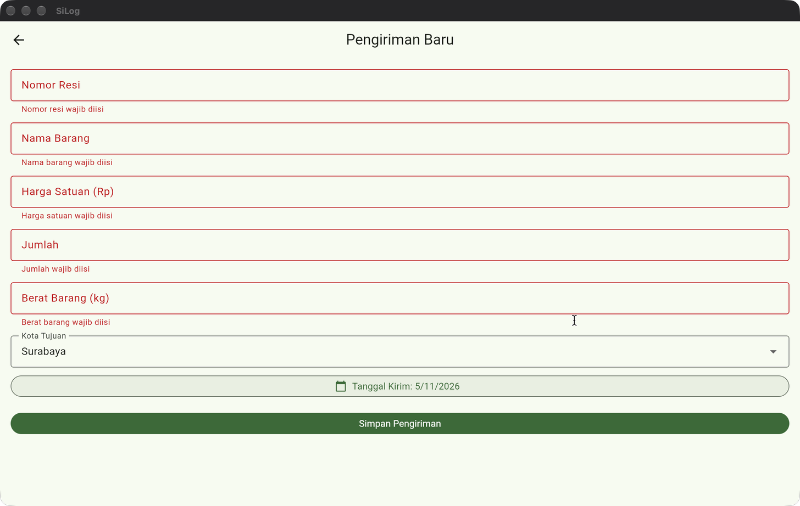
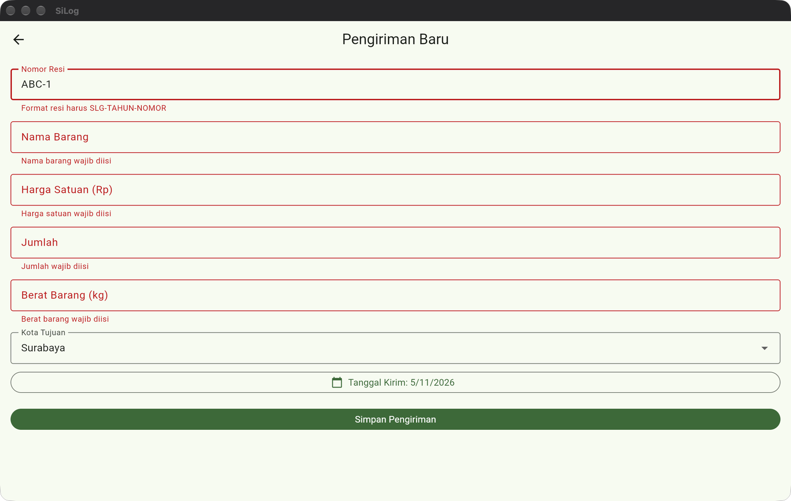
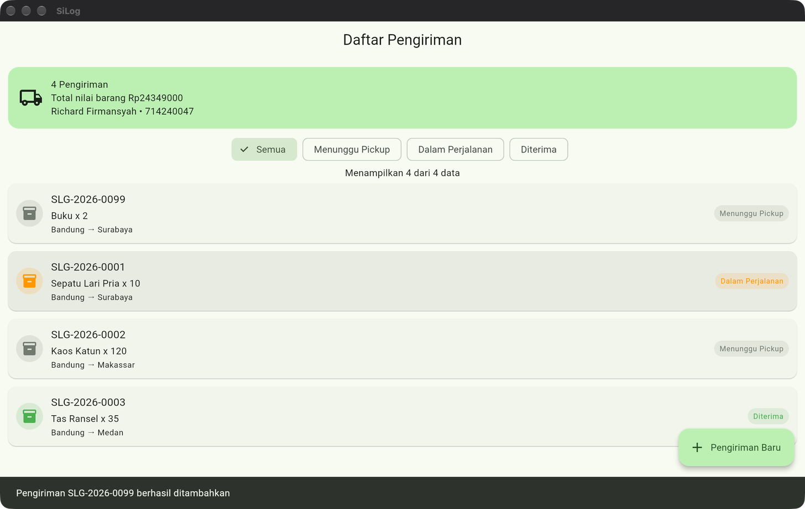
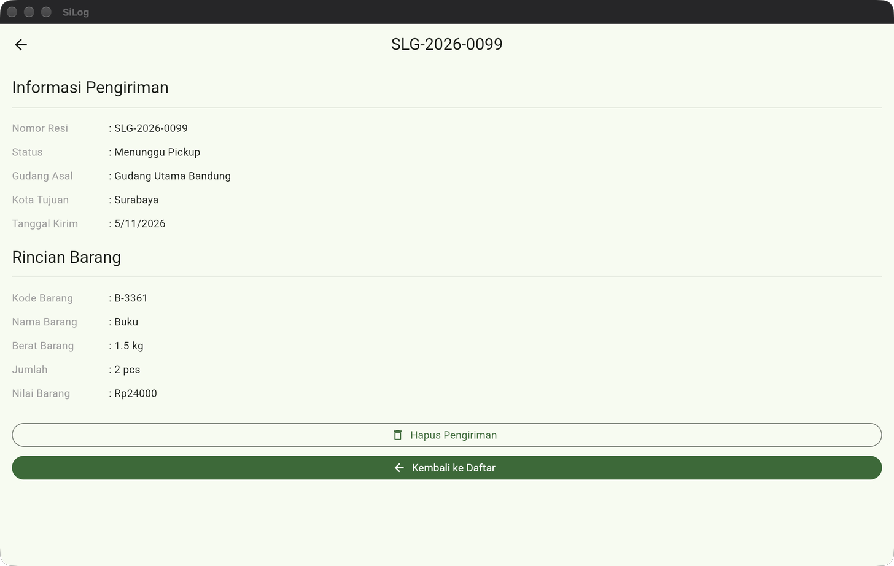
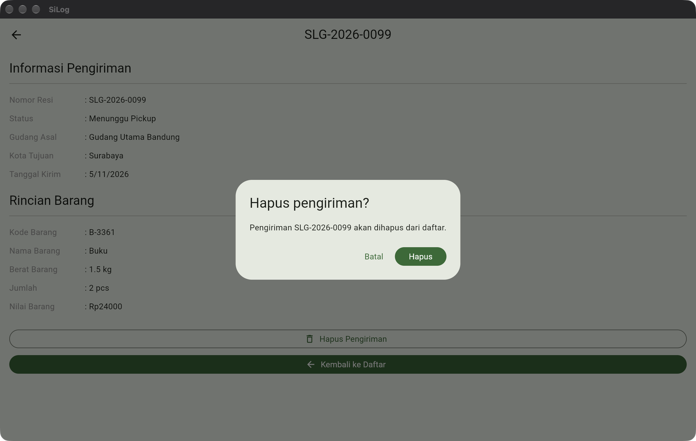
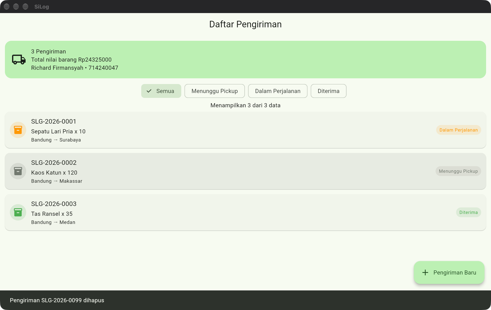
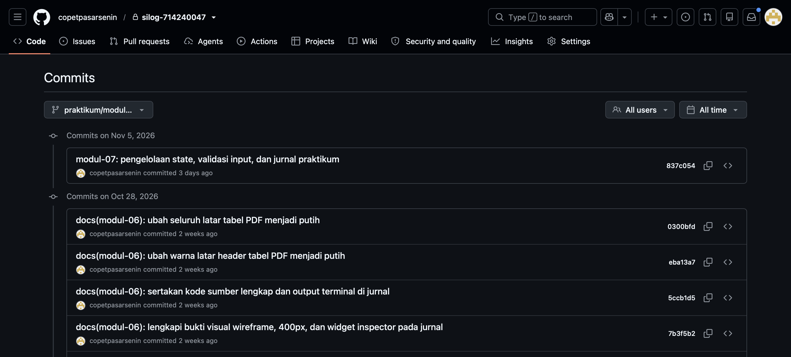

# Jurnal Praktikum Pemrograman IV - Modul 07

## 1. Identitas

| Keterangan | Isi |
| --- | --- |
| Nama | Richard Firmansyah |
| NIM | 714240047 |
| Kelas | 3C-D4-TI |
| Modul | Modul 07 - Pengelolaan State dan Validasi Input |
| Tanggal praktikum | 5 November 2026 |

## 2. Tujuan Praktikum

1. Mengubah daftar pengiriman menjadi `StatefulWidget` agar data dan filter berubah tanpa memuat ulang aplikasi.
2. Membuat formulir `Form` dan `TextFormField` dengan validasi masukan.
3. Mengembalikan objek `Pengiriman` dari formulir ke halaman daftar.
4. Menerapkan tugas tambahan: berat barang, pencegahan resi duplikat, dan penghapusan dengan konfirmasi.

## 3. Alat dan Bahan

| Alat | Versi/Keterangan |
| --- | --- |
| macOS | 27.2 |
| Flutter SDK | 3.47.4 stable |
| Dart SDK | 3.13.3 |
| Google Chrome | Pengujian aplikasi web lokal |
| GitHub | https://github.com/copetpasarsenin/silog-714240047 |

## 4. Langkah Kerja

1. Membuat branch `praktikum/modul-07` dari hasil Modul 06.
2. Mengubah `DaftarPengirimanPage` menjadi `StatefulWidget`; data contoh disalin ke `_daftar` pada `initState`.
3. Menambahkan filter status menggunakan `ChoiceChip` dan getter `_hasilSaring`.
4. Membuat `FormPengirimanPage` berisi field resi, nama barang, harga, jumlah, berat, tujuan, dan tanggal kirim.
5. Menerapkan validator field wajib, pola resi, angka, rentang berat, tanggal kirim, dan resi duplikat.
6. Mengembalikan objek `Pengiriman` memakai `Navigator.pop(context, pengiriman)`; halaman daftar memasukkannya pada indeks nol memakai `setState`.
7. Menambahkan halaman detail dengan tombol hapus dan `AlertDialog` konfirmasi.
8. Menjalankan formatter, analisis statis, seluruh widget/model test, build web release, serta uji interaksi di Chrome.

## 5. Kode Program dan Penjelasan

### 5.1 Kode `lib/tampilan/daftar_pengiriman_page.dart`

`_daftar` menjadi sumber data tunggal pada `DaftarPengirimanPage`. Getter `_hasilSaring` menyaring daftar berdasarkan `_filterStatus`. Penambahan dari formulir, perubahan filter `ChoiceChip`, dan penghapusan dari layar detail semuanya dijalankan di dalam `setState`.

```dart
import 'package:flutter/material.dart';

import '../data/data_contoh.dart';
import '../model/pengiriman.dart';
import '../widget/kartu_pengiriman.dart';
import 'detail_pengiriman_page.dart';
import 'form_pengiriman_page.dart';

class DaftarPengirimanPage extends StatefulWidget {
  const DaftarPengirimanPage({super.key});

  @override
  State<DaftarPengirimanPage> createState() => _DaftarPengirimanPageState();
}

class _DaftarPengirimanPageState extends State<DaftarPengirimanPage> {
  late List<Pengiriman> _daftar;
  String _filterStatus = 'Semua';

  @override
  void initState() {
    super.initState();
    _daftar = List<Pengiriman>.from(dataPengiriman);
  }

  List<Pengiriman> get _hasilSaring => _filterStatus == 'Semua'
      ? _daftar
      : _daftar.where((item) => item.status == _filterStatus).toList();

  bool _resiSudahAda(String resi) =>
      _daftar.any((item) => item.resi.toUpperCase() == resi.toUpperCase());

  Future<void> _bukaFormulir() async {
    final hasil = await Navigator.push<Pengiriman>(
      context,
      MaterialPageRoute(
        builder: (_) => FormPengirimanPage(resiSudahAda: _resiSudahAda),
      ),
    );
    if (hasil == null || !mounted) return;
    setState(() => _daftar.insert(0, hasil));
    ScaffoldMessenger.of(context).showSnackBar(
      SnackBar(content: Text('Pengiriman ${hasil.resi} berhasil ditambahkan')),
    );
  }

  Future<void> _bukaDetail(Pengiriman pengiriman) async {
    final dihapus = await Navigator.push<bool>(
      context,
      MaterialPageRoute(
        builder: (_) => DetailPengirimanPage(pengiriman: pengiriman),
      ),
    );
    if (dihapus != true || !mounted) return;
    setState(() => _daftar.remove(pengiriman));
    ScaffoldMessenger.of(context).showSnackBar(
      SnackBar(content: Text('Pengiriman ${pengiriman.resi} dihapus')),
    );
  }

  @override
  Widget build(BuildContext context) {
    const opsi = ['Semua', 'Menunggu Pickup', 'Dalam Perjalanan', 'Diterima'];
    final hasil = _hasilSaring;
    final totalNilai = _daftar.fold<double>(
      0,
      (total, item) => total + item.nilaiBarang,
    );

    return Scaffold(
      appBar: AppBar(title: const Text('Daftar Pengiriman')),
      body: Column(
        children: [
          Container(
            margin: const EdgeInsets.fromLTRB(12, 12, 12, 6),
            padding: const EdgeInsets.all(16),
            decoration: BoxDecoration(
              color: Theme.of(context).colorScheme.primaryContainer,
              borderRadius: BorderRadius.circular(16),
            ),
            child: Row(
              children: [
                const Icon(Icons.local_shipping_outlined, size: 36),
                const SizedBox(width: 12),
                Expanded(
                  child: Text(
                    '${_daftar.length} Pengiriman\n'
                    'Total nilai barang Rp${totalNilai.toStringAsFixed(0)}\n'
                    'Richard Firmansyah • 714240047',
                  ),
                ),
              ],
            ),
          ),
          SingleChildScrollView(
            scrollDirection: Axis.horizontal,
            padding: const EdgeInsets.symmetric(horizontal: 12, vertical: 8),
            child: Row(
              children: opsi.map((opsiStatus) {
                return Padding(
                  padding: const EdgeInsets.only(right: 8),
                  child: ChoiceChip(
                    label: Text(opsiStatus),
                    selected: _filterStatus == opsiStatus,
                    onSelected: (_) =>
                        setState(() => _filterStatus = opsiStatus),
                  ),
                );
              }).toList(),
            ),
          ),
          Text('Menampilkan ${hasil.length} dari ${_daftar.length} data'),
          Expanded(
            child: hasil.isEmpty
                ? const Center(child: Text('Tidak ada data pengiriman'))
                : ListView.builder(
                    itemCount: hasil.length,
                    itemBuilder: (context, index) {
                      final item = hasil[index];
                      return KartuPengiriman(
                        pengiriman: item,
                        onTap: () => _bukaDetail(item),
                      );
                    },
                  ),
          ),
        ],
      ),
      floatingActionButton: FloatingActionButton.extended(
        onPressed: _bukaFormulir,
        icon: const Icon(Icons.add),
        label: const Text('Pengiriman Baru'),
      ),
    );
  }
}
```

### 5.2 Kode `lib/tampilan/form_pengiriman_page.dart`

Formulir memakai `GlobalKey<FormState>`, lima `TextEditingController` yang dilepas pada `dispose()`, validator untuk field wajib, pola resi `^SLG-\d{4}-\d{4}$`, cek resi duplikat melalui callback `resiSudahAda`, rentang berat `0.1` sampai `5000` kg, serta validasi tanggal kirim.

```dart
import 'package:flutter/material.dart';
import 'package:flutter/services.dart';

import '../data/data_contoh.dart';
import '../model/barang.dart';
import '../model/pengiriman.dart';

class FormPengirimanPage extends StatefulWidget {
  final bool Function(String resi) resiSudahAda;

  const FormPengirimanPage({super.key, required this.resiSudahAda});

  @override
  State<FormPengirimanPage> createState() => _FormPengirimanPageState();
}

class _FormPengirimanPageState extends State<FormPengirimanPage> {
  final _formKey = GlobalKey<FormState>();
  final _resiC = TextEditingController();
  final _namaBarangC = TextEditingController();
  final _hargaC = TextEditingController();
  final _jumlahC = TextEditingController();
  final _beratC = TextEditingController();
  String _kotaTujuan = 'Surabaya';
  DateTime _tanggalKirim = DateTime.now();

  @override
  void dispose() {
    _resiC.dispose();
    _namaBarangC.dispose();
    _hargaC.dispose();
    _jumlahC.dispose();
    _beratC.dispose();
    super.dispose();
  }

  String? _wajib(String? nilai, String label) {
    if (nilai == null || nilai.trim().isEmpty) return '$label wajib diisi';
    return null;
  }

  String? _validasiResi(String? nilai) {
    final pesan = _wajib(nilai, 'Nomor resi');
    if (pesan != null) return pesan;
    final resi = nilai!.trim().toUpperCase();
    if (!RegExp(r'^SLG-\d{4}-\d{4}$').hasMatch(resi)) {
      return 'Format resi harus SLG-TAHUN-NOMOR';
    }
    if (widget.resiSudahAda(resi)) return 'Nomor resi sudah digunakan';
    return null;
  }

  String? _validasiAngka(
    String? nilai,
    String label, {
    required double minimum,
    double? maksimum,
  }) {
    final pesan = _wajib(nilai, label);
    if (pesan != null) return pesan;
    final angka = double.tryParse(nilai!.trim());
    if (angka == null) return '$label harus berupa angka';
    if (angka < minimum || (maksimum != null && angka > maksimum)) {
      return maksimum == null
          ? '$label minimal $minimum'
          : '$label harus antara $minimum dan $maksimum';
    }
    return null;
  }

  String? _validasiTanggal() {
    final batas = DateTime.now().subtract(const Duration(days: 1));
    if (_tanggalKirim.isBefore(batas)) {
      return 'Tanggal kirim tidak boleh sebelum hari ini';
    }
    return null;
  }

  Future<void> _pilihTanggal() async {
    final hasil = await showDatePicker(
      context: context,
      initialDate: _tanggalKirim,
      firstDate: DateTime.now(),
      lastDate: DateTime.now().add(const Duration(days: 90)),
    );
    if (hasil != null) setState(() => _tanggalKirim = hasil);
  }

  void _simpan() {
    final pesanTanggal = _validasiTanggal();
    if (!_formKey.currentState!.validate() || pesanTanggal != null) {
      if (pesanTanggal != null) {
        ScaffoldMessenger.of(
          context,
        ).showSnackBar(SnackBar(content: Text(pesanTanggal)));
      }
      return;
    }
    final pengiriman = Pengiriman(
      resi: _resiC.text.trim().toUpperCase(),
      asal: gudangBandung,
      kotaTujuan: _kotaTujuan,
      barang: Barang(
        kode: 'B-${DateTime.now().millisecondsSinceEpoch % 10000}',
        nama: _namaBarangC.text.trim(),
        hargaSatuan: double.parse(_hargaC.text.trim()),
        beratKg: double.parse(_beratC.text.trim()),
      ),
      jumlah: int.parse(_jumlahC.text.trim()),
      tanggalKirim: _tanggalKirim,
      pelanggan: pelangganContoh,
      status: 'Menunggu Pickup',
    );
    Navigator.pop(context, pengiriman);
  }

  @override
  Widget build(BuildContext context) {
    const kota = ['Surabaya', 'Makassar', 'Medan', 'Denpasar', 'Jayapura'];
    return Scaffold(
      appBar: AppBar(title: const Text('Pengiriman Baru')),
      body: Form(
        key: _formKey,
        autovalidateMode: AutovalidateMode.onUserInteraction,
        child: ListView(
          padding: const EdgeInsets.all(16),
          children: [
            TextFormField(
              key: const Key('resi'),
              controller: _resiC,
              decoration: const InputDecoration(
                labelText: 'Nomor Resi',
                hintText: 'SLG-2026-0010',
                border: OutlineInputBorder(),
              ),
              textCapitalization: TextCapitalization.characters,
              validator: _validasiResi,
            ),
            const SizedBox(height: 12),
            TextFormField(
              key: const Key('namaBarang'),
              controller: _namaBarangC,
              decoration: const InputDecoration(
                labelText: 'Nama Barang',
                border: OutlineInputBorder(),
              ),
              validator: (nilai) => _wajib(nilai, 'Nama barang'),
            ),
            const SizedBox(height: 12),
            TextFormField(
              key: const Key('harga'),
              controller: _hargaC,
              decoration: const InputDecoration(
                labelText: 'Harga Satuan (Rp)',
                border: OutlineInputBorder(),
              ),
              keyboardType: TextInputType.number,
              inputFormatters: [FilteringTextInputFormatter.digitsOnly],
              validator: (nilai) =>
                  _validasiAngka(nilai, 'Harga satuan', minimum: 1000),
            ),
            const SizedBox(height: 12),
            TextFormField(
              key: const Key('jumlah'),
              controller: _jumlahC,
              decoration: const InputDecoration(
                labelText: 'Jumlah',
                border: OutlineInputBorder(),
              ),
              keyboardType: TextInputType.number,
              inputFormatters: [FilteringTextInputFormatter.digitsOnly],
              validator: (nilai) => _validasiAngka(nilai, 'Jumlah', minimum: 1),
            ),
            const SizedBox(height: 12),
            TextFormField(
              key: const Key('berat'),
              controller: _beratC,
              decoration: const InputDecoration(
                labelText: 'Berat Barang (kg)',
                border: OutlineInputBorder(),
              ),
              keyboardType: const TextInputType.numberWithOptions(
                decimal: true,
              ),
              inputFormatters: [
                FilteringTextInputFormatter.allow(RegExp(r'^\d*\.?\d*$')),
              ],
              validator: (nilai) => _validasiAngka(
                nilai,
                'Berat barang',
                minimum: 0.1,
                maksimum: 5000,
              ),
            ),
            const SizedBox(height: 12),
            DropdownButtonFormField<String>(
              initialValue: _kotaTujuan,
              decoration: const InputDecoration(
                labelText: 'Kota Tujuan',
                border: OutlineInputBorder(),
              ),
              items: kota
                  .map(
                    (item) => DropdownMenuItem(value: item, child: Text(item)),
                  )
                  .toList(),
              onChanged: (nilai) => setState(() => _kotaTujuan = nilai!),
            ),
            const SizedBox(height: 12),
            OutlinedButton.icon(
              onPressed: _pilihTanggal,
              icon: const Icon(Icons.calendar_today),
              label: Text(
                'Tanggal Kirim: ${_tanggalKirim.day}/${_tanggalKirim.month}/${_tanggalKirim.year}',
              ),
            ),
            const SizedBox(height: 24),
            FilledButton(
              onPressed: _simpan,
              child: const Text('Simpan Pengiriman'),
            ),
          ],
        ),
      ),
    );
  }
}
```

### 5.3 Kode `lib/tampilan/detail_pengiriman_page.dart`

Halaman detail menampilkan berat barang serta tombol **Hapus Pengiriman** yang memunculkan `AlertDialog` konfirmasi sebelum mengembalikan nilai `true` ke halaman daftar.

```dart
import 'package:flutter/material.dart';

import '../model/pengiriman.dart';

class DetailPengirimanPage extends StatelessWidget {
  final Pengiriman pengiriman;

  const DetailPengirimanPage({super.key, required this.pengiriman});

  Widget _baris(String label, String nilai) {
    return Padding(
      padding: const EdgeInsets.symmetric(vertical: 6),
      child: Row(
        crossAxisAlignment: CrossAxisAlignment.start,
        children: [
          SizedBox(
            width: 130,
            child: Text(label, style: const TextStyle(color: Colors.grey)),
          ),
          const Text(': '),
          Expanded(child: Text(nilai)),
        ],
      ),
    );
  }

  Future<void> _konfirmasiHapus(BuildContext context) async {
    final setuju = await showDialog<bool>(
      context: context,
      builder: (dialogContext) => AlertDialog(
        title: const Text('Hapus pengiriman?'),
        content: Text(
          'Pengiriman ${pengiriman.resi} akan dihapus dari daftar.',
        ),
        actions: [
          TextButton(
            onPressed: () => Navigator.pop(dialogContext, false),
            child: const Text('Batal'),
          ),
          FilledButton(
            onPressed: () => Navigator.pop(dialogContext, true),
            child: const Text('Hapus'),
          ),
        ],
      ),
    );
    if (setuju == true && context.mounted) Navigator.pop(context, true);
  }

  @override
  Widget build(BuildContext context) {
    final tanggal = pengiriman.tanggalKirim;
    return Scaffold(
      appBar: AppBar(title: Text(pengiriman.resi)),
      body: SingleChildScrollView(
        padding: const EdgeInsets.all(16),
        child: Column(
          crossAxisAlignment: CrossAxisAlignment.start,
          children: [
            Text(
              'Informasi Pengiriman',
              style: Theme.of(context).textTheme.titleLarge,
            ),
            const Divider(height: 24),
            _baris('Nomor Resi', pengiriman.resi),
            _baris('Status', pengiriman.status),
            _baris('Gudang Asal', pengiriman.asal.nama),
            _baris('Kota Tujuan', pengiriman.kotaTujuan),
            _baris(
              'Tanggal Kirim',
              '${tanggal.day}/${tanggal.month}/${tanggal.year}',
            ),
            const SizedBox(height: 16),
            Text(
              'Rincian Barang',
              style: Theme.of(context).textTheme.titleLarge,
            ),
            const Divider(height: 24),
            _baris('Kode Barang', pengiriman.barang.kode),
            _baris('Nama Barang', pengiriman.barang.nama),
            _baris('Berat Barang', '${pengiriman.barang.beratKg} kg'),
            _baris(
              'Jumlah',
              '${pengiriman.jumlah} ${pengiriman.barang.satuan}',
            ),
            _baris(
              'Nilai Barang',
              'Rp${pengiriman.nilaiBarang.toStringAsFixed(0)}',
            ),
            const SizedBox(height: 24),
            SizedBox(
              width: double.infinity,
              child: OutlinedButton.icon(
                onPressed: () => _konfirmasiHapus(context),
                icon: const Icon(Icons.delete_outline),
                label: const Text('Hapus Pengiriman'),
              ),
            ),
            const SizedBox(height: 12),
            SizedBox(
              width: double.infinity,
              child: FilledButton.icon(
                onPressed: () => Navigator.pop(context),
                icon: const Icon(Icons.arrow_back),
                label: const Text('Kembali ke Daftar'),
              ),
            ),
          ],
        ),
      ),
    );
  }
}
```

### 5.4 Kode `test/widget_test.dart`

```dart
import 'package:flutter/material.dart';
import 'package:flutter_test/flutter_test.dart';
import 'package:silog_app/main.dart';

Future<void> bukaForm(WidgetTester tester) async {
  await tester.tap(find.text('Pengiriman Baru'));
  await tester.pumpAndSettle();
}

void main() {
  testWidgets('form menolak field kosong dan resi duplikat', (tester) async {
    await tester.pumpWidget(const SiLogApp());
    await bukaForm(tester);

    await tester.tap(find.text('Simpan Pengiriman'));
    await tester.pumpAndSettle();
    expect(find.text('Nomor resi wajib diisi'), findsOneWidget);
    expect(find.text('Nama barang wajib diisi'), findsOneWidget);
    expect(find.text('Harga satuan wajib diisi'), findsOneWidget);
    expect(find.text('Jumlah wajib diisi'), findsOneWidget);
    expect(find.text('Berat barang wajib diisi'), findsOneWidget);

    await tester.enterText(find.byKey(const Key('resi')), 'SLG-2026-0001');
    await tester.enterText(find.byKey(const Key('namaBarang')), 'Buku');
    await tester.enterText(find.byKey(const Key('harga')), '12000');
    await tester.enterText(find.byKey(const Key('jumlah')), '2');
    await tester.enterText(find.byKey(const Key('berat')), '0');
    final simpanDuplikat = find.text('Simpan Pengiriman');
    await tester.ensureVisible(simpanDuplikat);
    await tester.pumpAndSettle();
    await tester.tap(simpanDuplikat);
    await tester.pumpAndSettle();
    expect(find.text('Nomor resi sudah digunakan'), findsOneWidget);
    expect(
      find.text('Berat barang harus antara 0.1 dan 5000.0'),
      findsOneWidget,
    );
  });

  testWidgets('pengiriman valid ditambahkan lalu dapat dihapus', (
    tester,
  ) async {
    await tester.pumpWidget(const SiLogApp());
    await bukaForm(tester);

    await tester.enterText(find.byKey(const Key('resi')), 'SLG-2026-0099');
    await tester.enterText(find.byKey(const Key('namaBarang')), 'Buku');
    await tester.enterText(find.byKey(const Key('harga')), '12000');
    await tester.enterText(find.byKey(const Key('jumlah')), '2');
    await tester.enterText(find.byKey(const Key('berat')), '1.5');
    await tester.tap(find.text('Simpan Pengiriman'));
    await tester.pumpAndSettle();

    expect(find.text('SLG-2026-0099'), findsOneWidget);
    expect(
      find.text('Pengiriman SLG-2026-0099 berhasil ditambahkan'),
      findsOneWidget,
    );

    await tester.tap(find.text('SLG-2026-0099'));
    await tester.pumpAndSettle();
    final hapusPengiriman = find.text('Hapus Pengiriman');
    await tester.ensureVisible(hapusPengiriman);
    await tester.tap(hapusPengiriman);
    await tester.pumpAndSettle();
    expect(find.text('Hapus pengiriman?'), findsOneWidget);
    await tester.tap(find.text('Hapus'));
    await tester.pumpAndSettle();

    expect(find.text('SLG-2026-0099'), findsNothing);
  });
}
```

## 6. Hasil Pengujian dan Analisis

Perintah verifikasi yang dijalankan:

```text
$ dart format lib/ test/
Formatted 16 files (0 changed) in 0.07 seconds.

$ flutter analyze
Analyzing silog_app...
No issues found! (ran in 1.9s)

$ flutter test
00:05 +12: All tests passed!

$ flutter build web --release
✓ Built build/web

$ git branch -a
  main
  praktikum/modul-01
  praktikum/modul-02
  praktikum/modul-03
  praktikum/modul-04
  praktikum/modul-05
  praktikum/modul-06
* praktikum/modul-07
  remotes/origin/HEAD -> origin/main
  remotes/origin/main
  remotes/origin/praktikum/modul-01
  remotes/origin/praktikum/modul-02
  remotes/origin/praktikum/modul-04
  remotes/origin/praktikum/modul-05
  remotes/origin/praktikum/modul-06
  remotes/origin/praktikum/modul-07

$ git log --oneline -n 5
837c054 modul-07: pengelolaan state, validasi input, dan jurnal praktikum
0300bfd docs(modul-06): ubah seluruh latar tabel PDF menjadi putih
eba13a7 docs(modul-06): ubah warna latar header tabel PDF menjadi putih
5ccb1d5 docs(modul-06): sertakan kode sumber lengkap dan output terminal di jurnal
7b3f5b2 docs(modul-06): lengkapi bukti visual wireframe, 400px, dan widget inspector pada jurnal
```

Tabel kasus uji validasi:

| No. | Field / Fitur | Input Uji | Aturan Validasi | Hasil yang Diperoleh |
| --- | --- | --- | --- | --- |
| 1 | Semua field | Kosong (tekan Simpan) | Wajib diisi | Lulus: muncul 5 pesan `<Label> wajib diisi`. |
| 2 | Nomor Resi | `ABC-1` | Pola `^SLG-\d{4}-\d{4}$` | Lulus: ditolak dengan pesan `Format resi harus SLG-TAHUN-NOMOR`. |
| 3 | Nomor Resi | `SLG-2026-0001` | Tidak boleh duplikat | Lulus: ditolak dengan pesan `Nomor resi sudah digunakan`. |
| 4 | Harga Satuan | `< 1000` | Angka minimal 1000 | Lulus: ditolak dengan pesan `Harga satuan minimal 1000.0`. |
| 5 | Jumlah | `< 1` | Angka bulat minimal 1 | Lulus: ditolak dengan pesan `Jumlah minimal 1.0`. |
| 6 | Berat Barang | `0` / `1.5` | Angka 0,1 s.d. 5000 kg | Lulus: `0` ditolak (`Berat barang harus antara 0.1 dan 5000.0`), `1.5` diterima. |
| 7 | Simpan Pengiriman | `SLG-2026-0099`, Buku, Rp12000, 2, 1.5 kg | Seluruh field sah | Lulus: item tampil di urutan teratas daftar & snackbar konfirmasi muncul. |
| 8 | Hapus Pengiriman | Tekan Hapus Pengiriman -> Hapus | Konfirmasi `AlertDialog` | Lulus: dialog muncul, item terhapus dari daftar setelah dikonfirmasi. |

## 7. Bukti Visual

1. **Validasi Field Kosong pada Formulir Pengiriman Baru**
   

2. **Penolakan Format Nomor Resi Tidak Sah (`ABC-1`)**
   

3. **Pengiriman Baru (`SLG-2026-0099`) Berhasil Ditambahkan pada Urutan Teratas**
   

4. **Layar Detail Pengiriman Menampilkan Berat Barang (`1.5 kg`) dan Tombol Hapus**
   

5. **Dialog Konfirmasi (`AlertDialog`) Sebelum Menghapus Pengiriman**
   

6. **Daftar Pengiriman Setelah Item `SLG-2026-0099` Dihapus**
   

7. **Bukti Commit GitHub pada Branch `praktikum/modul-07` (`837c054`)**
   

## 8. Jawaban Tugas Praktikum

1. **Field Berat Barang (kg) dan Validasi (0,1 - 5000):** Field ditambahkan pada `FormPengirimanPage` dengan `TextInputType.numberWithOptions(decimal: true)` dan validator `_validasiAngka(nilai, 'Berat barang', minimum: 0.1, maksimum: 5000)`. Nilai yang sah disimpan pada properti `Barang.beratKg` dan ditampilkan pada `DetailPengirimanPage`.
2. **Pemeriksaan Nomor Resi Duplikat:** `DaftarPengirimanPage` meneruskan fungsi callback `_resiSudahAda` ke `FormPengirimanPage`. Fungsi `_validasiResi` memeriksa `widget.resiSudahAda(resi)` secara case-insensitive dan mengembalikan pesan error `'Nomor resi sudah digunakan'` apabila resi sudah terdaftar.
3. **Tombol Hapus dengan Konfirmasi `AlertDialog`:** Pada `DetailPengirimanPage` ditambahkan tombol `Hapus Pengiriman` yang memanggil `showDialog<bool>` berisi `AlertDialog`. Bila pengguna menekan `Hapus`, halaman detail ditutup dengan `Navigator.pop(context, true)`, lalu `DaftarPengirimanPage` menghapus item terkait di dalam `setState` dan menampilkan `SnackBar`.
4. **Alasan `TextEditingController` Wajib Dilepas pada `dispose`:** Setiap `TextEditingController` mendaftarkan listener internal ke `EditableText` dan memegang alokasi memori untuk nilai teks serta seleksi. Melepasnya pada `dispose()` menghentikan pemberitahuan perubahan setelah widget dihancurkan. Bila dilewatkan, objek controller dan listener tetap tertahan di memori (*memory leak*) serta berisiko memicu pembaruan pada state yang sudah tidak aktif (*unmounted*).

## 9. Kesimpulan dan Kendala

Pengelolaan state lokal menggunakan `StatefulWidget` dan `setState` berhasil diterapkan untuk pemfilteran status, penambahan pengiriman baru di urutan teratas, serta penghapusan pengiriman melalui konfirmasi `AlertDialog`. Validasi input menggunakan `Form` dan `TextFormField` memastikan seluruh field wajib, format resi, keunikan resi, dan batas nilai angka terpenuhi sebelum objek `Pengiriman` dibuat. Seluruh 12 pengujian otomatis (`flutter test`), analisis statis (`flutter analyze`), dan build web release berjalan tanpa error.

## 10. Repositori

- Repositori: https://github.com/copetpasarsenin/silog-714240047
- Branch: `praktikum/modul-07`
- Artefak utama: `lib/tampilan/daftar_pengiriman_page.dart`, `lib/tampilan/form_pengiriman_page.dart`, `lib/tampilan/detail_pengiriman_page.dart`, `test/widget_test.dart`, `JURNAL_MODUL_07.md`, `714240047_Richard_Firmansyah_Modul-07.pdf`, dan `bukti_visual_modul07/`.
