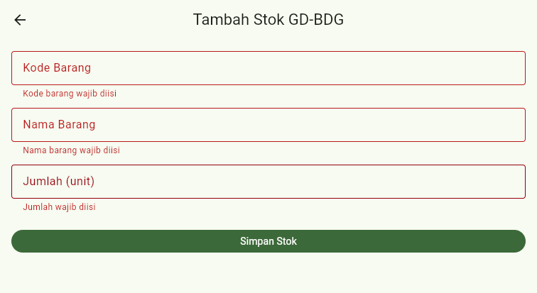
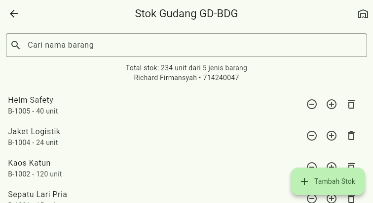
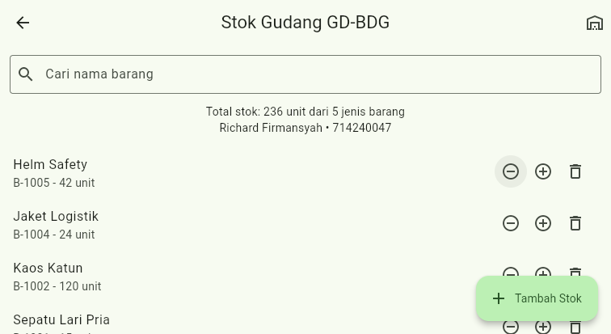
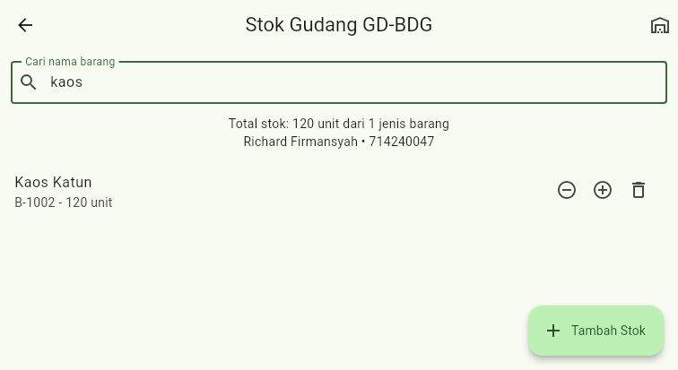
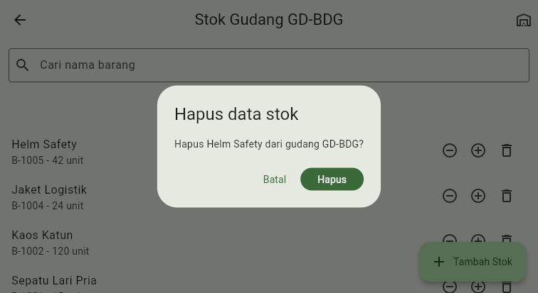
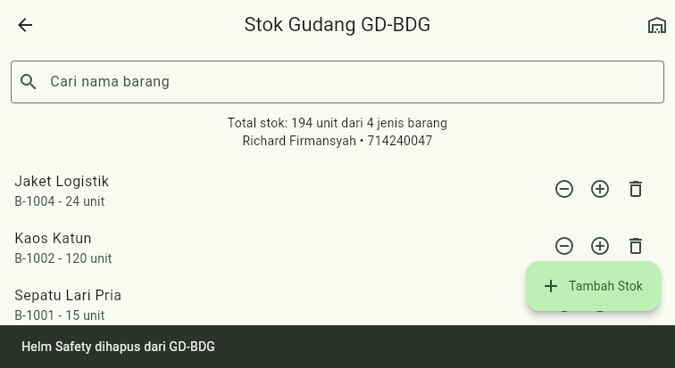
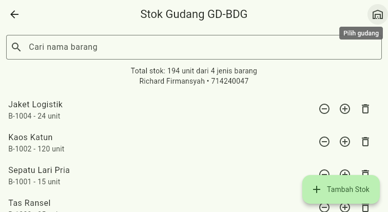
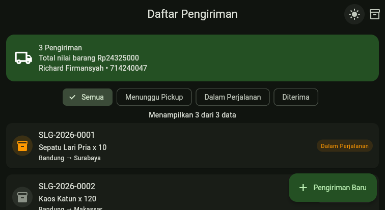
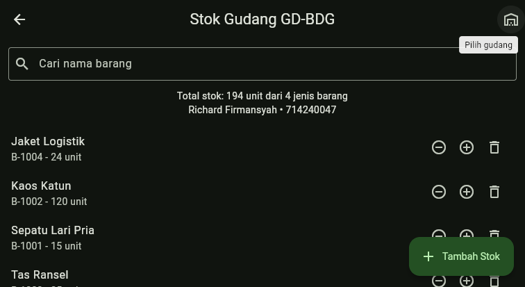

# Jurnal Praktikum Pemrograman IV - Modul 08

## 1. Identitas

| Keterangan | Isi |
| --- | --- |
| Nama | Richard Firmansyah |
| NIM | 714240047 |
| Kelas | 3C-D4-TI |
| Modul | Modul 08 - Penyimpanan Data Lokal |
| Tanggal praktikum | 11 November 2026 |

## 2. Tujuan Praktikum

1. Mengelola preferensi pengguna sederhana secara persisten menggunakan `shared_preferences`.
2. Merancang skema penyimpanan data lokal berbasis store dan dokumen beserta serialisasi `toMap()` dan `fromMap()`.
3. Memisahkan lapisan penyimpanan dari widget menggunakan pola repositori (`StokRepository`) di atas `sembast` lintas platform.
4. Menerapkan operasi simpan, baca, ubah, hapus, pencarian `Filter.matchesRegExp`, formulir tervalidasi, serta tema gelap persisten.

## 3. Alat dan Bahan

| Alat / Dependensi | Versi / Keterangan |
| --- | --- |
| macOS | 27.2 |
| Flutter SDK | 3.47.4 stable |
| Dart SDK | 3.13.3 |
| `shared_preferences` | `^2.5.6` (terpasang `2.5.6`) |
| `sembast` | `^3.10.1` (terpasang `3.10.1`) |
| `sembast_web` | `^2.4.7` (terpasang `2.4.7`) |
| `path_provider` | `^2.1.6` (terpasang `2.1.6`) |
| Google Chrome | Pengujian aplikasi web dan persistensi IndexedDB/localStorage |
| GitHub | https://github.com/copetpasarsenin/silog-714240047 (cabang `praktikum/modul-08`) |

## 4. Rancangan Skema Penyimpanan Lokal

- **Nama basis data lokal:** `silog.db` (pada web menggunakan `databaseFactoryWeb` di IndexedDB; pada desktop/mobile menggunakan `databaseFactoryIo` di `getApplicationDocumentsDirectory()`).
- **Nama store:** `stok` (`intMapStoreFactory.store('stok')`).

| Medan | Tipe | Wajib | Keterangan |
| --- | --- | --- | --- |
| `id (kunci record)` | `int (sembast)` | Otomatis | Kunci unik integer auto-increment pada intMapStoreFactory.store('stok') |
| `kodeBarang` | `String` | Ya | Pengenal barang pola ^B-\d{4}$, unik per gudang |
| `namaBarang` | `String` | Ya | Nama barang, kunci pengurutan SortOrder('namaBarang') & pencarian |
| `kodeGudang` | `String` | Ya | Penyaring utama Finder (GD-BDG, GD-JKT, GD-SBY) |
| `jumlah` | `int` | Ya | Jumlah stok (unit), tidak boleh bernilai negatif (>= 0) |
| `diperbaruiPada` | `String (ISO 8601)` | Ya | Stempel waktu pembaruan terakhir dalam format teks ISO 8601 |

Tabel preferensi pengguna pada `shared_preferences`:

| Kunci | Tipe | Nilai Bawaan | Keterangan |
| --- | --- | --- | --- |
| `gudang_terakhir` | `String` | `'GD-BDG'` | Kode gudang yang terakhir dipilih pengguna pada StokPage |
| `nama_petugas` | `String?` | `null` | Nama petugas gudang yang tersimpan pada Preferensi |
| `mode_gelap` | `bool` | `false` | Status tema gelap yang diterapkan pada MaterialApp.themeMode |

## 5. Langkah Kerja

1. Membuat cabang `praktikum/modul-08` dari `praktikum/modul-07`.
2. Menambahkan dependensi `shared_preferences`, `sembast`, `sembast_web`, dan `path_provider` ke `pubspec.yaml` melalui `flutter pub add`.
3. Membuat `lib/data/preferensi.dart` untuk menyimpan dan membaca `gudang_terakhir`, `nama_petugas`, serta `mode_gelap`.
4. Membuat model `lib/model/stok.dart` lengkap dengan penjagaan `jumlah >= 0`, `toMap()`, `fromMap()`, dan `salinDengan()`.
5. Membuat `lib/data/stok_repository.dart` berisi operasi CRUD, `totalStokGudang`, `kosongkan`, serta metode `cari()` berbasis `Filter.matchesRegExp`.
6. Membuat `lib/tampilan/form_stok_page.dart` sebagai formulir tervalidasi pengganti tombol data contoh, dan menghubungkannya dengan `lib/tampilan/stok_page.dart`.
7. Menghubungkan tombol `Stok Gudang` dan pengalih `Mode gelap` pada `AppBar` `DaftarPengirimanPage` serta menerapkan `ThemeMode` persisten pada `lib/main.dart`.
8. Menulis pengujian mandiri unit dan widget pada `test/modul08_penyimpanan_test.dart`.
9. Menjalankan `dart format`, `flutter analyze`, `flutter test`, dan `flutter build web --release`.
10. Menguji langsung seluruh operasi tambah, tampil, ubah jumlah, cari, hapus, muat ulang browser (F5), dan buka ulang tab baru pada Google Chrome.

## 6. Kode Program dan Penjelasan Singkat

### 6.1 `lib/data/preferensi.dart`

Lapisan penyimpanan preferensi pengguna (kode gudang terakhir, nama petugas, dan mode gelap) memakai `shared_preferences`.

```dart
import 'package:shared_preferences/shared_preferences.dart';

class Preferensi {
  static const _kGudang = 'gudang_terakhir';
  static const _kPetugas = 'nama_petugas';
  static const _kModeGelap = 'mode_gelap';

  Future<void> simpanGudangTerakhir(String kodeGudang) async {
    final sp = await SharedPreferences.getInstance();
    await sp.setString(_kGudang, kodeGudang);
  }

  Future<String> ambilGudangTerakhir() async {
    final sp = await SharedPreferences.getInstance();
    return sp.getString(_kGudang) ?? 'GD-BDG';
  }

  Future<void> simpanPetugas(String nama) async {
    final sp = await SharedPreferences.getInstance();
    await sp.setString(_kPetugas, nama);
  }

  Future<String?> ambilPetugas() async {
    final sp = await SharedPreferences.getInstance();
    return sp.getString(_kPetugas);
  }

  Future<void> setModeGelap(bool aktif) async {
    final sp = await SharedPreferences.getInstance();
    await sp.setBool(_kModeGelap, aktif);
  }

  Future<bool> modeGelap() async {
    final sp = await SharedPreferences.getInstance();
    return sp.getBool(_kModeGelap) ?? false;
  }

  Future<void> bersihkan() async {
    final sp = await SharedPreferences.getInstance();
    await sp.clear();
  }
}
```

### 6.2 `lib/model/stok.dart`

Model domain `Stok` beserta validasi jumlah tidak negatif, metode serialisasi `toMap()`, deserialisasi `fromMap()`, dan `salinDengan()`.

```dart
class Stok {
  final int? id;
  final String kodeBarang;
  final String namaBarang;
  final String kodeGudang;
  final int jumlah;
  final DateTime diperbaruiPada;

  Stok({
    this.id,
    required this.kodeBarang,
    required this.namaBarang,
    required this.kodeGudang,
    required this.jumlah,
    required this.diperbaruiPada,
  }) {
    if (jumlah < 0) throw ArgumentError('Jumlah stok tidak boleh negatif');
  }

  Map<String, Object?> toMap() => {
    'kodeBarang': kodeBarang,
    'namaBarang': namaBarang,
    'kodeGudang': kodeGudang,
    'jumlah': jumlah,
    'diperbaruiPada': diperbaruiPada.toIso8601String(),
  };

  factory Stok.fromMap(int id, Map<String, Object?> map) => Stok(
    id: id,
    kodeBarang: map['kodeBarang'] as String,
    namaBarang: map['namaBarang'] as String,
    kodeGudang: map['kodeGudang'] as String,
    jumlah: map['jumlah'] as int,
    diperbaruiPada: DateTime.parse(map['diperbaruiPada'] as String),
  );

  Stok salinDengan({int? jumlah}) => Stok(
    id: id,
    kodeBarang: kodeBarang,
    namaBarang: namaBarang,
    kodeGudang: kodeGudang,
    jumlah: jumlah ?? this.jumlah,
    diperbaruiPada: DateTime.now(),
  );

  @override
  String toString() => '[$kodeBarang] $namaBarang @ $kodeGudang = $jumlah';
}
```

### 6.3 `lib/data/stok_repository.dart`

Pola repositori `StokRepository` yang membungkus seluruh operasi CRUD `sembast` (`simpan`, `ambilSemua`, `cari`, `ambilSatu`, `perbarui`, `hapus`, `totalStokGudang`, `kosongkan`) lintas web (`databaseFactoryWeb`) dan non-web (`databaseFactoryIo`). Konstruktor `@visibleForTesting StokRepository.denganDatabase(Database db)` memungkinkan pengujian terisolasi dengan basis data memori.

```dart
import 'package:flutter/foundation.dart' show kIsWeb, visibleForTesting;
import 'package:path_provider/path_provider.dart';
import 'package:sembast/sembast_io.dart';
import 'package:sembast_web/sembast_web.dart';

import '../model/stok.dart';

class StokRepository {
  static final StokRepository instance = StokRepository._();
  StokRepository._();

  /// Dipakai pengujian dengan basis data memori agar repositori diuji mandiri.
  @visibleForTesting
  StokRepository.denganDatabase(Database db) : _db = db;

  Database? _db;
  final _store = intMapStoreFactory.store('stok');

  Future<Database> get _database async {
    if (_db != null) return _db!;
    if (kIsWeb) {
      _db = await databaseFactoryWeb.openDatabase('silog.db');
    } else {
      final dir = await getApplicationDocumentsDirectory();
      _db = await databaseFactoryIo.openDatabase('${dir.path}/silog.db');
    }
    return _db!;
  }

  List<Stok> _keStok(List<RecordSnapshot<int, Map<String, Object?>>> rekaman) =>
      rekaman.map((r) => Stok.fromMap(r.key, r.value)).toList();

  /// CREATE
  Future<int> simpan(Stok stok) async {
    final db = await _database;
    return _store.add(db, stok.toMap());
  }

  /// READ - seluruh data, diurutkan berdasarkan nama barang
  Future<List<Stok>> ambilSemua({String? kodeGudang}) async {
    final db = await _database;
    final finder = Finder(
      filter: kodeGudang == null
          ? null
          : Filter.equals('kodeGudang', kodeGudang),
      sortOrders: [SortOrder('namaBarang')],
    );
    return _keStok(await _store.find(db, finder: finder));
  }

  /// READ - pencarian nama barang (tidak peka huruf besar/kecil)
  Future<List<Stok>> cari(String kata, {String? kodeGudang}) async {
    final db = await _database;
    final filterNama = Filter.matchesRegExp(
      'namaBarang',
      RegExp(RegExp.escape(kata.trim()), caseSensitive: false),
    );
    final finder = Finder(
      filter: kodeGudang == null
          ? filterNama
          : Filter.and([Filter.equals('kodeGudang', kodeGudang), filterNama]),
      sortOrders: [SortOrder('namaBarang')],
    );
    return _keStok(await _store.find(db, finder: finder));
  }

  /// READ - satu data
  Future<Stok?> ambilSatu(int id) async {
    final db = await _database;
    final nilai = await _store.record(id).get(db);
    return nilai == null ? null : Stok.fromMap(id, nilai);
  }

  /// UPDATE
  Future<void> perbarui(Stok stok) async {
    if (stok.id == null) {
      throw ArgumentError('Data tanpa id tidak dapat diperbarui');
    }
    final db = await _database;
    await _store.record(stok.id!).update(db, stok.toMap());
  }

  /// DELETE
  Future<void> hapus(int id) async {
    final db = await _database;
    await _store.record(id).delete(db);
  }

  Future<int> totalStokGudang(String kodeGudang) async {
    final daftar = await ambilSemua(kodeGudang: kodeGudang);
    return daftar.fold<int>(0, (a, s) => a + s.jumlah);
  }

  Future<void> kosongkan() async {
    final db = await _database;
    await _store.delete(db);
  }
}
```

### 6.4 `lib/tampilan/form_stok_page.dart`

Formulir input stok (`FormStokPage`) dengan validasi kode barang (`^B-\d{4}$` dan unik per gudang), nama barang minimal 3 karakter, dan jumlah bilangan bulat 0–100.000, menggantikan tombol tambah data contoh.

```dart
import 'package:flutter/material.dart';
import 'package:flutter/services.dart';

import '../model/stok.dart';

class FormStokPage extends StatefulWidget {
  final String kodeGudang;
  final bool Function(String kodeBarang) kodeSudahAda;

  const FormStokPage({
    super.key,
    required this.kodeGudang,
    required this.kodeSudahAda,
  });

  @override
  State<FormStokPage> createState() => _FormStokPageState();
}

class _FormStokPageState extends State<FormStokPage> {
  final _formKey = GlobalKey<FormState>();
  final _kodeC = TextEditingController();
  final _namaC = TextEditingController();
  final _jumlahC = TextEditingController();

  @override
  void dispose() {
    _kodeC.dispose();
    _namaC.dispose();
    _jumlahC.dispose();
    super.dispose();
  }

  String? _validasiKode(String? nilai) {
    final kode = (nilai ?? '').trim().toUpperCase();
    if (kode.isEmpty) return 'Kode barang wajib diisi';
    if (!RegExp(r'^B-\d{4}$').hasMatch(kode)) {
      return 'Format kode harus B-NNNN';
    }
    if (widget.kodeSudahAda(kode)) return 'Kode barang sudah ada di gudang ini';
    return null;
  }

  String? _validasiNama(String? nilai) {
    final nama = (nilai ?? '').trim();
    if (nama.isEmpty) return 'Nama barang wajib diisi';
    if (nama.length < 3) return 'Nama barang minimal 3 karakter';
    return null;
  }

  String? _validasiJumlah(String? nilai) {
    if ((nilai ?? '').trim().isEmpty) return 'Jumlah wajib diisi';
    final jumlah = int.tryParse(nilai!.trim());
    if (jumlah == null) return 'Jumlah harus berupa bilangan bulat';
    if (jumlah < 0 || jumlah > 100000) {
      return 'Jumlah harus antara 0 dan 100000';
    }
    return null;
  }

  void _simpan() {
    if (!_formKey.currentState!.validate()) return;
    Navigator.pop(
      context,
      Stok(
        kodeBarang: _kodeC.text.trim().toUpperCase(),
        namaBarang: _namaC.text.trim(),
        kodeGudang: widget.kodeGudang,
        jumlah: int.parse(_jumlahC.text.trim()),
        diperbaruiPada: DateTime.now(),
      ),
    );
  }

  @override
  Widget build(BuildContext context) {
    return Scaffold(
      appBar: AppBar(title: Text('Tambah Stok ${widget.kodeGudang}')),
      body: Form(
        key: _formKey,
        autovalidateMode: AutovalidateMode.onUserInteraction,
        child: ListView(
          padding: const EdgeInsets.all(16),
          children: [
            TextFormField(
              key: const Key('kodeBarang'),
              controller: _kodeC,
              decoration: const InputDecoration(
                labelText: 'Kode Barang',
                hintText: 'B-1024',
                border: OutlineInputBorder(),
              ),
              textCapitalization: TextCapitalization.characters,
              validator: _validasiKode,
            ),
            const SizedBox(height: 12),
            TextFormField(
              key: const Key('namaStok'),
              controller: _namaC,
              decoration: const InputDecoration(
                labelText: 'Nama Barang',
                border: OutlineInputBorder(),
              ),
              validator: _validasiNama,
            ),
            const SizedBox(height: 12),
            TextFormField(
              key: const Key('jumlahStok'),
              controller: _jumlahC,
              decoration: const InputDecoration(
                labelText: 'Jumlah (unit)',
                border: OutlineInputBorder(),
              ),
              keyboardType: TextInputType.number,
              inputFormatters: [FilteringTextInputFormatter.digitsOnly],
              validator: _validasiJumlah,
            ),
            const SizedBox(height: 24),
            FilledButton(onPressed: _simpan, child: const Text('Simpan Stok')),
          ],
        ),
      ),
    );
  }
}
```

### 6.5 `lib/tampilan/stok_page.dart`

Layar pengelolaan stok gudang (`StokPage`) berisi kolom pencarian berbasis `Filter.matchesRegExp`, pemilih gudang aktif tersimpan ke preferensi, daftar stok terurut abjad, tombol ubah jumlah (`-`/`+`), konfirmasi hapus `AlertDialog` disertai `SnackBar`, dan FAB menuju `FormStokPage`.

```dart
import 'package:flutter/material.dart';

import '../data/preferensi.dart';
import '../data/stok_repository.dart';
import '../model/stok.dart';
import 'form_stok_page.dart';

class StokPage extends StatefulWidget {
  final StokRepository? repository;

  const StokPage({super.key, this.repository});

  @override
  State<StokPage> createState() => _StokPageState();
}

class _StokPageState extends State<StokPage> {
  static const _opsiGudang = ['GD-BDG', 'GD-JKT', 'GD-SBY'];

  late final StokRepository _repo =
      widget.repository ?? StokRepository.instance;
  final _pref = Preferensi();
  final _cariC = TextEditingController();

  List<Stok> _daftar = [];
  String _gudang = 'GD-BDG';
  bool _memuat = true;

  @override
  void initState() {
    super.initState();
    _muat();
  }

  @override
  void dispose() {
    _cariC.dispose();
    super.dispose();
  }

  Future<void> _muat() async {
    setState(() => _memuat = true);
    _gudang = await _pref.ambilGudangTerakhir();
    final kata = _cariC.text.trim();
    final data = kata.isEmpty
        ? await _repo.ambilSemua(kodeGudang: _gudang)
        : await _repo.cari(kata, kodeGudang: _gudang);
    if (!mounted) return;
    setState(() {
      _daftar = data;
      _memuat = false;
    });
  }

  Future<void> _gantiGudang(String kode) async {
    await _pref.simpanGudangTerakhir(kode);
    await _muat();
  }

  Future<void> _bukaFormulir() async {
    final semua = await _repo.ambilSemua(kodeGudang: _gudang);
    if (!mounted) return;
    final stok = await Navigator.push<Stok>(
      context,
      MaterialPageRoute(
        builder: (_) => FormStokPage(
          kodeGudang: _gudang,
          kodeSudahAda: (kode) => semua.any((s) => s.kodeBarang == kode),
        ),
      ),
    );
    if (stok == null) return;
    await _repo.simpan(stok);
    await _muat();
    if (!mounted) return;
    ScaffoldMessenger.of(context).showSnackBar(
      SnackBar(content: Text('${stok.namaBarang} disimpan ke $_gudang')),
    );
  }

  Future<void> _ubahJumlah(Stok stok, int delta) async {
    final baru = stok.jumlah + delta;
    if (baru < 0) return;
    await _repo.perbarui(stok.salinDengan(jumlah: baru));
    await _muat();
  }

  Future<void> _hapus(Stok stok) async {
    final ya = await showDialog<bool>(
      context: context,
      builder: (context) => AlertDialog(
        title: const Text('Hapus data stok'),
        content: Text('Hapus ${stok.namaBarang} dari gudang $_gudang?'),
        actions: [
          TextButton(
            onPressed: () => Navigator.pop(context, false),
            child: const Text('Batal'),
          ),
          FilledButton(
            onPressed: () => Navigator.pop(context, true),
            child: const Text('Hapus'),
          ),
        ],
      ),
    );
    if (ya == true && stok.id != null) {
      await _repo.hapus(stok.id!);
      await _muat();
      if (!mounted) return;
      ScaffoldMessenger.of(context).showSnackBar(
        SnackBar(content: Text('${stok.namaBarang} dihapus dari $_gudang')),
      );
    }
  }

  @override
  Widget build(BuildContext context) {
    final total = _daftar.fold<int>(0, (a, s) => a + s.jumlah);

    return Scaffold(
      appBar: AppBar(
        title: Text('Stok Gudang $_gudang'),
        actions: [
          PopupMenuButton<String>(
            tooltip: 'Pilih gudang',
            icon: const Icon(Icons.warehouse_outlined),
            onSelected: _gantiGudang,
            itemBuilder: (_) => _opsiGudang
                .map((g) => PopupMenuItem(value: g, child: Text(g)))
                .toList(),
          ),
        ],
      ),
      body: Column(
        children: [
          Padding(
            padding: const EdgeInsets.fromLTRB(12, 12, 12, 0),
            child: TextField(
              key: const Key('cariStok'),
              controller: _cariC,
              decoration: const InputDecoration(
                labelText: 'Cari nama barang',
                prefixIcon: Icon(Icons.search),
                border: OutlineInputBorder(),
              ),
              onChanged: (_) => _muat(),
            ),
          ),
          Padding(
            padding: const EdgeInsets.all(12),
            child: Text(
              'Total stok: $total unit dari ${_daftar.length} jenis barang\n'
              'Richard Firmansyah • 714240047',
              textAlign: TextAlign.center,
            ),
          ),
          Expanded(
            child: _memuat
                ? const Center(child: CircularProgressIndicator())
                : _daftar.isEmpty
                ? const Center(child: Text('Belum ada data stok'))
                : ListView.builder(
                    itemCount: _daftar.length,
                    itemBuilder: (context, i) {
                      final s = _daftar[i];
                      return ListTile(
                        title: Text(s.namaBarang),
                        subtitle: Text('${s.kodeBarang} - ${s.jumlah} unit'),
                        trailing: Row(
                          mainAxisSize: MainAxisSize.min,
                          children: [
                            IconButton(
                              tooltip: 'Kurangi',
                              icon: const Icon(Icons.remove_circle_outline),
                              onPressed: () => _ubahJumlah(s, -1),
                            ),
                            IconButton(
                              tooltip: 'Tambah',
                              icon: const Icon(Icons.add_circle_outline),
                              onPressed: () => _ubahJumlah(s, 1),
                            ),
                            IconButton(
                              tooltip: 'Hapus',
                              icon: const Icon(Icons.delete_outline),
                              onPressed: () => _hapus(s),
                            ),
                          ],
                        ),
                      );
                    },
                  ),
          ),
        ],
      ),
      floatingActionButton: FloatingActionButton.extended(
        onPressed: _bukaFormulir,
        icon: const Icon(Icons.add),
        label: const Text('Tambah Stok'),
      ),
    );
  }
}
```

### 6.6 `lib/tampilan/daftar_pengiriman_page.dart`

Penambahan dua aksi pada `AppBar` `DaftarPengirimanPage`: tombol pengalih tema terang/gelap yang langsung menyimpan pilihan ke `Preferensi` dan tombol navigasi menuju `StokPage`.

```dart
import 'package:flutter/material.dart';

import '../data/data_contoh.dart';
import '../data/preferensi.dart';
import '../main.dart' show modeGelap;
import '../model/pengiriman.dart';
import '../widget/kartu_pengiriman.dart';
import 'detail_pengiriman_page.dart';
import 'form_pengiriman_page.dart';
import 'stok_page.dart';

class DaftarPengirimanPage extends StatefulWidget {
  const DaftarPengirimanPage({super.key});

  @override
  State<DaftarPengirimanPage> createState() => _DaftarPengirimanPageState();
}

class _DaftarPengirimanPageState extends State<DaftarPengirimanPage> {
  late List<Pengiriman> _daftar;
  String _filterStatus = 'Semua';

  @override
  void initState() {
    super.initState();
    _daftar = List<Pengiriman>.from(dataPengiriman);
  }

  List<Pengiriman> get _hasilSaring => _filterStatus == 'Semua'
      ? _daftar
      : _daftar.where((item) => item.status == _filterStatus).toList();

  bool _resiSudahAda(String resi) =>
      _daftar.any((item) => item.resi.toUpperCase() == resi.toUpperCase());

  Future<void> _bukaFormulir() async {
    final hasil = await Navigator.push<Pengiriman>(
      context,
      MaterialPageRoute(
        builder: (_) => FormPengirimanPage(resiSudahAda: _resiSudahAda),
      ),
    );
    if (hasil == null || !mounted) return;
    setState(() => _daftar.insert(0, hasil));
    ScaffoldMessenger.of(context).showSnackBar(
      SnackBar(content: Text('Pengiriman ${hasil.resi} berhasil ditambahkan')),
    );
  }

  Future<void> _bukaDetail(Pengiriman pengiriman) async {
    final dihapus = await Navigator.push<bool>(
      context,
      MaterialPageRoute(
        builder: (_) => DetailPengirimanPage(pengiriman: pengiriman),
      ),
    );
    if (dihapus != true || !mounted) return;
    setState(() => _daftar.remove(pengiriman));
    ScaffoldMessenger.of(context).showSnackBar(
      SnackBar(content: Text('Pengiriman ${pengiriman.resi} dihapus')),
    );
  }

  @override
  Widget build(BuildContext context) {
    const opsi = ['Semua', 'Menunggu Pickup', 'Dalam Perjalanan', 'Diterima'];
    final hasil = _hasilSaring;
    final totalNilai = _daftar.fold<double>(
      0,
      (total, item) => total + item.nilaiBarang,
    );

    return Scaffold(
      appBar: AppBar(
        title: const Text('Daftar Pengiriman'),
        actions: [
          ValueListenableBuilder<bool>(
            valueListenable: modeGelap,
            builder: (context, gelap, _) => IconButton(
              tooltip: gelap ? 'Mode terang' : 'Mode gelap',
              icon: Icon(gelap ? Icons.light_mode : Icons.dark_mode),
              onPressed: () async {
                modeGelap.value = !gelap;
                await Preferensi().setModeGelap(!gelap);
              },
            ),
          ),
          IconButton(
            tooltip: 'Stok Gudang',
            icon: const Icon(Icons.inventory_2_outlined),
            onPressed: () => Navigator.push(
              context,
              MaterialPageRoute(builder: (_) => const StokPage()),
            ),
          ),
        ],
      ),
      body: Column(
        children: [
          Container(
            margin: const EdgeInsets.fromLTRB(12, 12, 12, 6),
            padding: const EdgeInsets.all(16),
            decoration: BoxDecoration(
              color: Theme.of(context).colorScheme.primaryContainer,
              borderRadius: BorderRadius.circular(16),
            ),
            child: Row(
              children: [
                const Icon(Icons.local_shipping_outlined, size: 36),
                const SizedBox(width: 12),
                Expanded(
                  child: Text(
                    '${_daftar.length} Pengiriman\n'
                    'Total nilai barang Rp${totalNilai.toStringAsFixed(0)}\n'
                    'Richard Firmansyah • 714240047',
                  ),
                ),
              ],
            ),
          ),
          SingleChildScrollView(
            scrollDirection: Axis.horizontal,
            padding: const EdgeInsets.symmetric(horizontal: 12, vertical: 8),
            child: Row(
              children: opsi.map((opsiStatus) {
                return Padding(
                  padding: const EdgeInsets.only(right: 8),
                  child: ChoiceChip(
                    label: Text(opsiStatus),
                    selected: _filterStatus == opsiStatus,
                    onSelected: (_) =>
                        setState(() => _filterStatus = opsiStatus),
                  ),
                );
              }).toList(),
            ),
          ),
          Text('Menampilkan ${hasil.length} dari ${_daftar.length} data'),
          Expanded(
            child: hasil.isEmpty
                ? const Center(child: Text('Tidak ada data pengiriman'))
                : ListView.builder(
                    itemCount: hasil.length,
                    itemBuilder: (context, index) {
                      final item = hasil[index];
                      return KartuPengiriman(
                        pengiriman: item,
                        onTap: () => _bukaDetail(item),
                      );
                    },
                  ),
          ),
        ],
      ),
      floatingActionButton: FloatingActionButton.extended(
        onPressed: _bukaFormulir,
        icon: const Icon(Icons.add),
        label: const Text('Pengiriman Baru'),
      ),
    );
  }
}
```

### 6.7 `lib/main.dart`

Inisialisasi `WidgetsFlutterBinding.ensureInitialized()`, pembacaan status awal `modeGelap` dari `Preferensi()` sebelum `runApp`, serta penerapan `theme`, `darkTheme`, dan `themeMode` melalui `ValueListenableBuilder<bool>`.

```dart
import 'package:flutter/material.dart';

import 'data/preferensi.dart';
import 'tampilan/daftar_pengiriman_page.dart';

/// Mode gelap aktif; nilai awal dibaca dari shared_preferences.
final modeGelap = ValueNotifier<bool>(false);

Future<void> main() async {
  WidgetsFlutterBinding.ensureInitialized();
  modeGelap.value = await Preferensi().modeGelap();
  runApp(const SiLogApp());
}

ThemeData _tema(Brightness brightness) => ThemeData(
  useMaterial3: true,
  colorScheme: ColorScheme.fromSeed(
    seedColor: const Color(0xFF1B5E20),
    brightness: brightness,
  ),
  cardTheme: CardThemeData(
    elevation: 1,
    shape: RoundedRectangleBorder(borderRadius: BorderRadius.circular(12)),
  ),
  appBarTheme: const AppBarTheme(centerTitle: true),
);

class SiLogApp extends StatelessWidget {
  const SiLogApp({super.key});

  @override
  Widget build(BuildContext context) {
    return ValueListenableBuilder<bool>(
      valueListenable: modeGelap,
      builder: (context, gelap, _) => MaterialApp(
        title: 'SiLog',
        debugShowCheckedModeBanner: false,
        theme: _tema(Brightness.light),
        darkTheme: _tema(Brightness.dark),
        themeMode: gelap ? ThemeMode.dark : ThemeMode.light,
        home: const DaftarPengirimanPage(),
      ),
    );
  }
}
```

### 6.8 `test/modul08_penyimpanan_test.dart`

Pengujian unit dan widget untuk serialisasi `Stok`, seluruh operasi CRUD + pencarian `StokRepository` di atas `newDatabaseFactoryMemory()`, penyimpanan `Preferensi`, serta validasi `FormStokPage` melalui `StokPage`.

```dart
import 'package:flutter/material.dart';
import 'package:flutter_test/flutter_test.dart';
import 'package:sembast/sembast_memory.dart';
import 'package:shared_preferences/shared_preferences.dart';
import 'package:silog_app/data/preferensi.dart';
import 'package:silog_app/data/stok_repository.dart';
import 'package:silog_app/model/stok.dart';
import 'package:silog_app/tampilan/stok_page.dart';

Stok stok(String kode, String nama, int jumlah, {String gudang = 'GD-BDG'}) =>
    Stok(
      kodeBarang: kode,
      namaBarang: nama,
      kodeGudang: gudang,
      jumlah: jumlah,
      diperbaruiPada: DateTime(2026, 11, 11),
    );

Future<StokRepository> repoBaru() async => StokRepository.denganDatabase(
  await newDatabaseFactoryMemory().openDatabase('uji.db'),
);

void main() {
  test('serialisasi toMap/fromMap dan jumlah negatif ditolak', () {
    final asli = stok('B-1024', 'Sepatu', 10);
    final balik = Stok.fromMap(7, asli.toMap());
    expect(balik.id, 7);
    expect(balik.toString(), asli.toString());
    expect(balik.diperbaruiPada, asli.diperbaruiPada);
    expect(() => stok('B-1', 'X', -1), throwsArgumentError);
  });

  test('repositori: simpan, baca, ubah, hapus, cari', () async {
    final repo = await repoBaru();
    final id = await repo.simpan(stok('B-0001', 'Kaos Katun', 20));
    await repo.simpan(stok('B-0002', 'Air Mineral', 5));
    await repo.simpan(stok('B-0003', 'Kaos Polo', 7, gudang: 'GD-JKT'));

    final bdg = await repo.ambilSemua(kodeGudang: 'GD-BDG');
    expect(bdg.map((s) => s.namaBarang), ['Air Mineral', 'Kaos Katun']);
    expect(await repo.totalStokGudang('GD-BDG'), 25);

    final satu = (await repo.ambilSatu(id))!;
    await repo.perbarui(satu.salinDengan(jumlah: 30));
    expect((await repo.ambilSatu(id))!.jumlah, 30);
    expect(
      () => repo.perbarui(stok('B-9', 'Tanpa Id', 1)),
      throwsArgumentError,
    );

    expect((await repo.cari('kaos')).length, 2);
    expect(
      (await repo.cari('KAOS', kodeGudang: 'GD-JKT')).single.kodeBarang,
      'B-0003',
    );
    expect(await repo.cari('(('), isEmpty, reason: 'regex di-escape');

    await repo.hapus(id);
    expect(await repo.ambilSatu(id), isNull);
    await repo.kosongkan();
    expect(await repo.ambilSemua(), isEmpty);
  });

  test('preferensi gudang terakhir dan mode gelap tersimpan', () async {
    SharedPreferences.setMockInitialValues({});
    final pref = Preferensi();
    expect(await pref.ambilGudangTerakhir(), 'GD-BDG');
    expect(await pref.modeGelap(), isFalse);
    await pref.simpanGudangTerakhir('GD-JKT');
    await pref.setModeGelap(true);
    expect(await pref.ambilGudangTerakhir(), 'GD-JKT');
    expect(await pref.modeGelap(), isTrue);
  });

  testWidgets('StokPage: form validasi lalu stok tampil', (tester) async {
    SharedPreferences.setMockInitialValues({});
    final repo = await tester.runAsync(repoBaru);
    await tester.runAsync(() => repo!.simpan(stok('B-0001', 'Kaos Katun', 4)));
    await tester.pumpWidget(MaterialApp(home: StokPage(repository: repo)));
    await tester.runAsync(
      () => Future.delayed(const Duration(milliseconds: 50)),
    );
    await tester.pumpAndSettle();
    expect(find.text('Kaos Katun'), findsOneWidget);

    await tester.tap(find.text('Tambah Stok'));
    await tester.pumpAndSettle();
    await tester.tap(find.text('Simpan Stok'));
    await tester.pumpAndSettle();
    expect(find.text('Kode barang wajib diisi'), findsOneWidget);
    expect(find.text('Nama barang wajib diisi'), findsOneWidget);
    expect(find.text('Jumlah wajib diisi'), findsOneWidget);

    await tester.enterText(find.byKey(const Key('kodeBarang')), 'B-0001');
    await tester.enterText(find.byKey(const Key('namaStok')), 'Ab');
    await tester.pumpAndSettle();
    expect(find.text('Kode barang sudah ada di gudang ini'), findsOneWidget);
    expect(find.text('Nama barang minimal 3 karakter'), findsOneWidget);
  });
}
```

## 7. Hasil Eksekusi, Analisis, dan Penanganan Kendala

```text
$ flutter analyze
Analyzing silog_app...
No issues found! (ran in 1.9s)

$ flutter test -r expanded test/modul08_penyimpanan_test.dart
00:00 +0: loading /Users/macbookpro/praktikum-pemrograman4/silog_app/test/modul08_penyimpanan_test.dart
00:00 +0: serialisasi toMap/fromMap dan jumlah negatif ditolak
00:00 +1: repositori: simpan, baca, ubah, hapus, cari
00:00 +2: preferensi gudang terakhir dan mode gelap tersimpan
00:00 +3: StokPage: form validasi lalu stok tampil
00:04 +4: All tests passed!

$ flutter test
00:06 +16: All tests passed!

$ flutter build web --release
Compiling lib/main.dart for the Web...                             31.6s
✓ Built build/web
```

| No. | Operasi / Fitur | Aksi Uji | Hasil yang Diamati |
| --- | --- | --- | --- |
| 1 | Validasi FormStokPage | Tekan Simpan Stok saat kosong; isi kode duplikat & nama 2 huruf | Muncul error wajib diisi; kode duplikat dan nama < 3 karakter ditolak |
| 2 | Create (simpan) | Tambah 5 barang stok pada GD-BDG | 5 item tersimpan ke silog.db (total 234 unit dari 5 jenis barang) |
| 3 | Read & Sort (ambilSemua) | Buka StokPage GD-BDG | Daftar terurut abjad berdasarkan namaBarang dengan total stok di header |
| 4 | Update (perbarui) | Tekan + 3x lalu - 1x pada Helm Safety (40) | Jumlah Helm Safety berubah menjadi 42 unit; total gudang menjadi 236 unit |
| 5 | Search (cari) | Ketik "kaos" pada kolom pencarian | Filter.matchesRegExp menampilkan 1 item: Kaos Katun (120 unit) |
| 6 | Delete (hapus) | Tekan ikon hapus -> konfirmasi AlertDialog | Helm Safety terhapus, SnackBar muncul, sisa 4 jenis barang (194 unit) |
| 7 | Persistensi Reload (F5) | Muat ulang browser (Page.reload) | 4 data stok (194 unit) tetap dimuat utuh dari IndexedDB silog.db |
| 8 | Mode Gelap & Restart | Aktifkan mode gelap lalu tutup & buka ulang tab baru | localStorage menyimpan flutter.mode_gelap=true; tema gelap & 4 stok bertahan |

### Analisis Error / Kendala dan Penyelesaian

1. **Karakter khusus pada pencarian RegExp (`Filter.matchesRegExp`):** Jika pengguna mengetik simbol seperti `(` atau `[` pada kolom pencarian, konstruktor `RegExp(kata)` dapat melempar `FormatException`. Penyelesaiannya adalah membungkus kata kunci dengan `RegExp.escape(kata.trim())` di `StokRepository.cari()` dan mengujinya secara eksplisit pada `modul08_penyimpanan_test.dart`.
2. **Isolasi pengujian lapisan penyimpanan:** `databaseFactoryWeb` maupun `getApplicationDocumentsDirectory()` bergantung pada platform saat runtime. Dengan menyediakan konstruktor `@visibleForTesting StokRepository.denganDatabase(Database db)` yang menerima `newDatabaseFactoryMemory()`, seluruh operasi CRUD dan query `StokRepository` dapat diuji langsung di VM tanpa tergantung widget maupun platform browser.
3. **Pergeseran posisi FAB akibat `SnackBar` saat interaksi beruntun:** Ketika `SnackBar` konfirmasi penyimpanan muncul di bagian bawah layar, `Scaffold` menggeser `FloatingActionButton` ke atas selama durasi `SnackBar` (4 detik). Pada pengujian interaksi beruntun di browser, jeda antar-input harus menunggu `SnackBar` selesai atau menarget posisi FAB secara dinamis agar klik tidak mengenai area kosong di bawah FAB.

## 8. Bukti Visual

1. **Gambar 1. Validasi field wajib pada FormStokPage (Tugas 1)**
   Saat tombol Simpan Stok ditekan dalam keadaan kosong, FormStokPage menampilkan pesan kesalahan validasi untuk Kode Barang, Nama Barang, dan Jumlah.

   

2. **Gambar 2. Penambahan dan penampilan daftar 5 data stok pada GD-BDG**
   Lima barang stok (Sepatu Lari Pria, Kaos Katun, Tas Ransel, Jaket Logistik, dan Helm Safety) berhasil disimpan ke store stok pada silog.db dengan total 234 unit dari 5 jenis barang.

   

3. **Gambar 3. Operasi ubah jumlah stok melalui tombol tambah dan kurang**
   Jumlah stok Helm Safety (B-1005) diperbarui dari 40 unit menjadi 42 unit melalui ikon tambah/kurang pada baris daftar sehingga total gudang menjadi 236 unit.

   

4. **Gambar 4. Fitur pencarian nama barang dengan Filter.matchesRegExp (Tugas 2)**
   Memasukkan kata kunci "kaos" memanggil StokRepository.cari() dengan Filter.matchesRegExp (case-insensitive) sehingga menampilkan tepat Kaos Katun (120 unit).

   

5. **Gambar 5. Dialog konfirmasi AlertDialog sebelum penghapusan data stok**
   Menekan ikon hapus pada Helm Safety menampilkan AlertDialog konfirmasi dengan tombol Batal dan Hapus.

   

6. **Gambar 6. Daftar stok sesudah penghapusan sebelum muat ulang halaman**
   Setelah konfirmasi Hapus, Helm Safety dihapus dari store stok dengan SnackBar konfirmasi; tersisa 4 jenis barang dengan total 194 unit.

   

7. **Gambar 7. Daftar stok tetap bertahan sesudah halaman browser dimuat ulang (F5)**
   Setelah Page.reload penuh pada Google Chrome, seluruh 4 data stok (total 194 unit) dimuat ulang utuh dari basis data IndexedDB silog.db.

   

8. **Gambar 8. Penerapan preferensi mode gelap pada ThemeData aplikasi (Tugas 3)**
   Menekan tombol mode gelap di AppBar memperbarui ValueNotifier modeGelap dan menyimpan flutter.mode_gelap=true ke shared_preferences (localStorage).

   

9. **Gambar 9. Tema gelap dan 4 data stok tetap bertahan sesudah aplikasi dijalankan kembali**
   Setelah tab ditutup dan aplikasi dibuka ulang di sesi/tab baru, preferensi mode gelap dan keempat rekaman stok (194 unit) tetap aktif tanpa kehilangan data.

   

## 9. Jawaban Tugas Praktikum

1. **Formulir Penambahan Stok dengan Validasi (`FormStokPage`):** Tombol data contoh diganti dengan `FormStokPage` yang memiliki tiga `TextFormField`: `Kode Barang` (wajib, harus sesuai pola `^B-\d{4}$`, dan dicek unik pada gudang aktif via callback `kodeSudahAda`), `Nama Barang` (wajib, minimal 3 karakter), dan `Jumlah (unit)` (wajib, hanya angka melalui `FilteringTextInputFormatter.digitsOnly`, rentang 0–100.000). Objek `Stok` yang sah dikembalikan via `Navigator.pop(context, stok)` lalu disimpan oleh `StokPage` melalui `_repo.simpan(stok)`.
2. **Pencarian Nama Barang Memakai `Filter.matchesRegExp`:** `StokRepository.cari(String kata, {String? kodeGudang})` membentuk filter `Filter.matchesRegExp('namaBarang', RegExp(RegExp.escape(kata.trim()), caseSensitive: false))` dan menggabungkannya dengan `Filter.equals('kodeGudang', kodeGudang)` melalui `Filter.and(...)`. Pada `StokPage`, perubahan teks pada `TextField` pencarian memanggil `_muat()` sehingga daftar langsung terfilter sesuai gudang aktif.
3. **Penyimpanan Preferensi Mode Gelap dan Penerapan pada `ThemeData`:** `main()` memanggil `WidgetsFlutterBinding.ensureInitialized()` dan mengisi `modeGelap.value = await Preferensi().modeGelap()` sebelum `runApp()`. `SiLogApp` membungkus `MaterialApp` dengan `ValueListenableBuilder<bool>` yang menyediakan `theme: _tema(Brightness.light)`, `darkTheme: _tema(Brightness.dark)`, dan `themeMode: gelap ? ThemeMode.dark : ThemeMode.light`. Pengguna mengubah tema lewat tombol di `AppBar` `DaftarPengirimanPage` yang sekaligus memanggil `Preferensi().setModeGelap(!gelap)`.
4. **Rumusan Topik Calon Proyek Akhir Bidang Logistik dan Rantai Pasok (Persiapan Modul 12):**
   - **Judul:** *SiRantai — Sistem Pemantauan Distribusi dan Pengisian Ulang Stok Gudang Multi-Cabang Berbasis Pelacakan Real-Time dan Peringatan Ambang Minimum*.
   - **Permasalahan:** Distributor logistik skala menengah masih memisahkan catatan stok gudang dan laporan pengiriman kurir menggunakan spreadsheet serta pesan singkat. Akibatnya, kekosongan stok (*stockout*) di gudang cabang, keterlambatan pengiriman, serta selisih jumlah barang saat serah terima sering terlambat diketahui oleh manajer pusat.
   - **Pengguna Sasaran:** (1) Operator Gudang Cabang yang mencatat stok masuk/keluar dan menyiapkan paket pengiriman, (2) Petugas/Kurir Pengiriman yang memperbarui status pengantaran dan konfirmasi serah terima, serta (3) Manajer Logistik Pusat yang memantau ketersediaan stok lintas gudang dan ketepatan jadwal kirim.
   - **Tiga Fitur Utama:**
     1. *Manajemen Stok Multi-Gudang dan Peringatan Ambang Minimum*: pencatatan stok per cabang dengan pencarian cepat, filter gudang, serta penanda otomatis ketika stok turun di bawah batas aman.
     2. *Pencatatan dan Pelacakan Status Pengiriman Tervalidasi*: pembuatan resi otomatis, pelacakan status (*Menunggu Pickup*, *Dalam Perjalanan*, *Diterima*), dan pencatatan bobot/nilai barang.
     3. *Penyimpanan Lokal Offline-First dan Dasbor Ringkasan Operasional*: pencatatan tetap berjalan di area gudang bersinyal lemah memakai basis data lokal dan disinkronkan saat koneksi tersedia, disertai ringkasan metrik harian.
   - **Bagian yang Dikerjakan Sendiri (Richard Firmansyah - 714240047):** Merancang skema basis data lokal dan preferensi pengguna (`StokRepository`, `Preferensi`, serialisasi model), mengimplementasikan layar manajemen stok dan formulir validasi (`StokPage`, `FormStokPage`), menerapkan sistem tema/preferensi persisten, serta menyusun rangkaian pengujian unit dan widget otomatis.

## 10. Kesimpulan dan Kendala

Penyimpanan data lokal menggunakan `shared_preferences` dan `sembast` (`databaseFactoryWeb` dan `databaseFactoryIo`) berhasil diterapkan pada `silog_app`. Seluruh operasi CRUD (`simpan`, `ambilSemua`, `cari`, `perbarui`, `hapus`), validasi formulir stok, pencarian `Filter.matchesRegExp`, dan preferensi mode gelap berjalan baik serta bertahan setelah muat ulang halaman (F5) maupun penutupan dan pembukaan ulang aplikasi. Seluruh 16 pengujian otomatis, analisis statis `flutter analyze`, dan `flutter build web --release` selesai tanpa error.

## 11. Repositori

- Repositori GitHub: https://github.com/copetpasarsenin/silog-714240047
- Cabang: `praktikum/modul-08`
- Berkas utama: `lib/data/preferensi.dart`, `lib/model/stok.dart`, `lib/data/stok_repository.dart`, `lib/tampilan/form_stok_page.dart`, `lib/tampilan/stok_page.dart`, `lib/tampilan/daftar_pengiriman_page.dart`, `lib/main.dart`, `test/modul08_penyimpanan_test.dart`, `JURNAL_MODUL_08.md`, `714240047_Richard_Firmansyah_Modul-08.pdf`, dan `bukti_visual_modul08/`.
