# Jurnal Praktikum Pemrograman IV - Modul 09

## 1. Identitas

| Keterangan | Isi |
| --- | --- |
| Nama | Richard Firmansyah |
| NPM | 714240047 |
| Kelas | [D4-TI-3C] |
| Modul | 09 - Integrasi Layanan Web |
| Tanggal | 25 November 2026 |

---

## 2. Tujuan Praktikum

1. Memahami mekanisme komunikasi asinkron antara aplikasi Flutter dan layanan web RESTful menggunakan paket `http` pada metode `GET`, `POST`, `PUT`, dan `DELETE`.
2. Menerapkan serialisasi dan deserialisasi data JSON secara aman melalui kelas model `Order` (`fromJson` dan `toJson`) beserta penanganan nilai bawaan apabila field respons bernilai `null`.
3. Membangun antarmuka pengguna reaktif berbasis `FutureBuilder`, `RefreshIndicator`, `TextField` pencarian real-time, dialog pembaruan data, serta umpan balik aksi melalui `SnackBar`.
4. Merancang penanganan kesalahan jaringan yang kompatibel dengan platform Flutter Web (Google Chrome) menggunakan pengecualian `http.ClientException`, `TimeoutException`, dan `FormatException` tanpa bergantung pada `SocketException` dari `dart:io`.
5. Mengintegrasikan penyimpanan lokal `sembast` dan `sembast_web` (`OrderCache`) sebagai mekanisme cadangan (*offline fallback*) saat layanan web tidak dapat dijangkau, lengkap dengan fitur pembersihan cache untuk keperluan pengujian.
6. Memverifikasi kebenaran logika API, cache lokal, serta interaksi antarmuka pengguna melalui pengujian otomatis (`flutter analyze` dan `flutter test`).

---

## 3. Alat dan Bahan

| Alat / Dependensi | Versi / Keterangan |
| --- | --- |
| Sistem Operasi | macOS (`macos_x64`) |
| Flutter SDK | `3.47.4` (channel `stable`, revision `9584c6713b`, DevTools `2.60.0`) |
| Dart SDK | `3.13.3` (`stable`) |
| `http` | `^1.6.0` |
| `sembast` | `^3.10.1` |
| `sembast_web` | `^2.4.7` |
| `path_provider` | `^2.1.6` |
| `flutter_lints` | `^6.0.0` |
| Peramban Web | Google Chrome (`flutter run -d chrome` dan Chrome DevTools tab Network untuk simulasi *offline*) |
| Klien API | Postman (pengujian awal endpoint `GET` dan `POST`) |
| Layanan Web Uji | JSONPlaceholder (`https://jsonplaceholder.typicode.com`) |
| Kontrol Versi | Git dan GitHub (`https://github.com/copetpasarsenin/silog-714240047/tree/praktikum/modul-09`) |

---

## 4. Langkah Kerja

### 4.1 Persiapan Branch, Dependensi `http`, dan Pengujian Awal Postman

1. Memeriksa status repositori lokal dengan `git status`, kemudian membuat sekaligus berpindah ke cabang baru `praktikum/modul-09` dari `praktikum/modul-08` menggunakan perintah `git checkout -b praktikum/modul-09`.
2. Menambahkan dependensi `http` ke dalam berkas `pubspec.yaml` melalui perintah `flutter pub add http` sehingga terpasang versi `^1.6.0`.
3. Menguji endpoint layanan web JSONPlaceholder secara mandiri di Postman sebelum diintegrasikan ke kode Flutter:
   - Mengirim permintaan `GET https://jsonplaceholder.typicode.com/posts?_limit=10` untuk memastikan server mengembalikan status `200 OK` beserta daftar sepuluh objek JSON.
   - Mengirim permintaan `POST https://jsonplaceholder.typicode.com/posts` dengan header `Content-Type: application/json; charset=UTF-8` dan badan JSON order baru untuk memastikan server mengembalikan status `201 Created` beserta `id` simulasi (`101`).

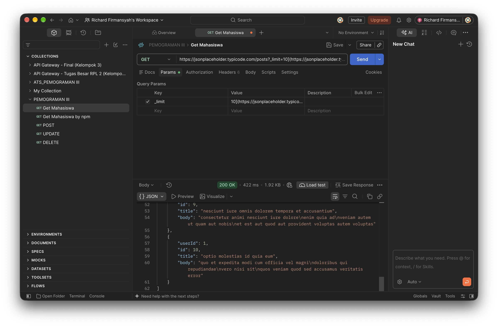

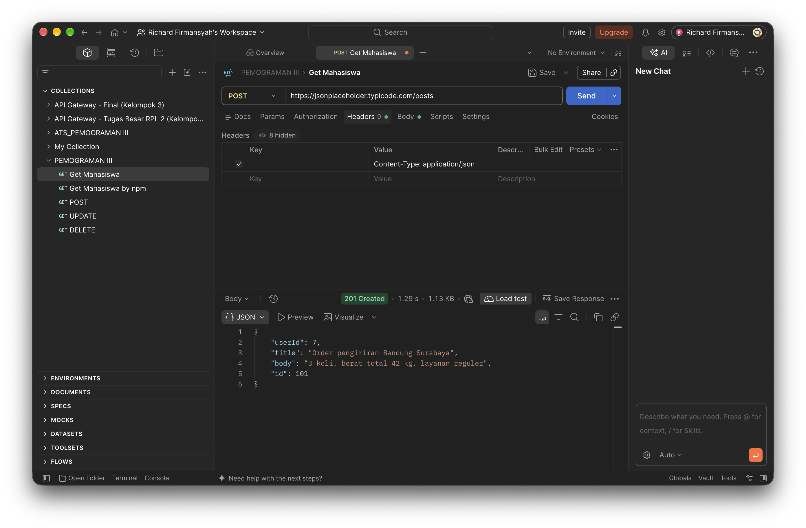

### 4.2 Pembuatan Model `Order` dan Layanan `OrderApi`

1. Membuat berkas `lib/model/order.dart` yang mendefinisikan kelas `Order` dengan atribut `id` (`int?`), `idPelanggan` (`int`), `judul` (`String`), dan `keterangan` (`String`).
2. Menambahkan konstruktor `factory Order.fromJson(Map<String, dynamic> json)` untuk memetakan `userId` ke `idPelanggan`, `title` ke `judul` (nilai bawaan `'(tanpa judul)'`), dan `body` ke `keterangan` (nilai bawaan `''`), serta metode `toJson()` dan `toString()`.
3. Membuat berkas `lib/data/order_api.dart` berisi kelas pengecualian khusus `GagalApi` (`pesan`, `kode`) dan kelas `OrderApi` dengan basis URL `https://jsonplaceholder.typicode.com` serta batas waktu `Duration(seconds: 12)`.
4. Mengimplementasikan `ambilDaftar({int limit = 10})`, `kirimOrder(Order order)` (dilengkapi `debugPrint` untuk `statusCode` dan `id`), serta `tutup()`. Seluruh pemanggilan jaringan dibungkus pembantu `_jalankan()` yang menangkap `TimeoutException`, `http.ClientException`, dan `FormatException` tanpa mengimpor `dart:io` agar aman dijalankan di Chrome.

### 4.3 Pembuatan `OrderPage` dan Navigasi dari `DaftarPengirimanPage`

1. Membuat berkas `lib/tampilan/order_page.dart` berupa `StatefulWidget` yang menginisialisasi `_api` dan `_future` pada `initState()`, lalu menutup klien HTTP pada `dispose()`.
2. Menyusun `AppBar` dengan judul `'Order dari Layanan Web'`, subjudul `'Richard Firmansyah - 714240047'` (`fontSize: 12`), serta tombol ikon muat ulang di `actions`.
3. Mengelola empat kondisi `FutureBuilder<List<Order>>`: indikator `CircularProgressIndicator` saat menunggu, ikon `Icons.cloud_off` (ukuran `56`, abu-abu) beserta pesan kesalahan dan tombol `FilledButton.icon` `'Coba Lagi'` saat gagal, pesan `'Belum ada order yang tercatat'` saat daftar kosong, serta `RefreshIndicator` + `ListView.separated` saat data tersedia.
4. Menambahkan `FloatingActionButton.extended` bertuliskan `'Kirim Order'` untuk mengirim data contoh (`idPelanggan: 7`, `judul: 'Order pengiriman Bandung Surabaya'`, `keterangan: '3 koli, berat total 42 kg, layanan reguler'`) dan menampilkan hasilnya melalui `SnackBar`.
5. Menambahkan tombol ikon `Icons.cloud_download_outlined` berlabel tooltip `'Order Layanan Web'` pada `AppBar` di `lib/tampilan/daftar_pengiriman_page.dart` untuk membuka `OrderPage`.

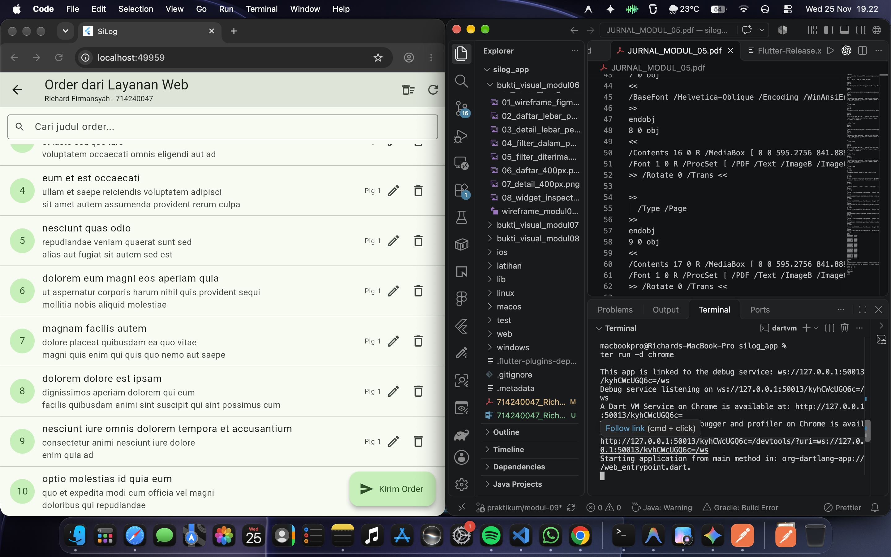

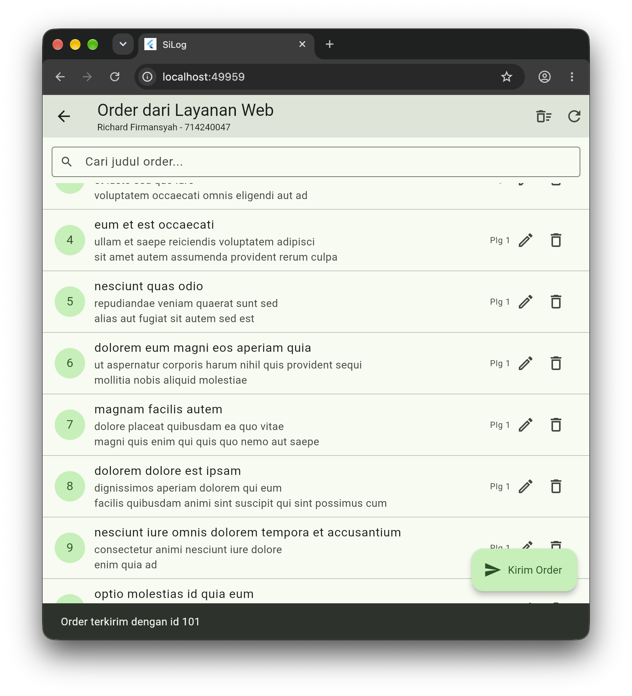

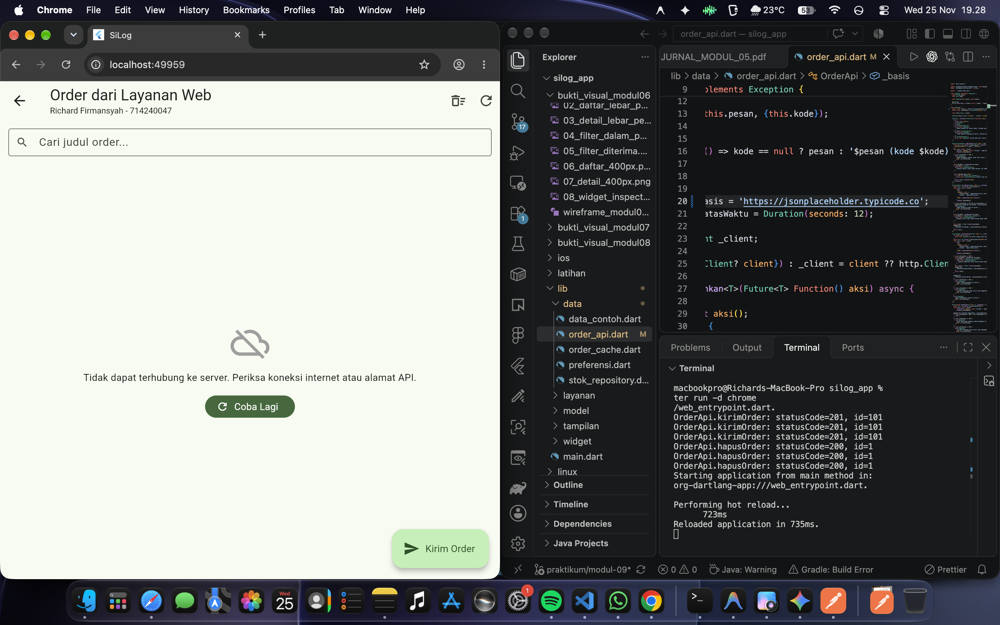

### 4.4 Integrasi Cache Lokal Sembast (`OrderCache`) untuk Fallback Offline

1. Memeriksa pola persistensi lokal pada `lib/data/stok_repository.dart` (Modul 08) yang memanfaatkan basis data `silog.db` melalui `databaseFactoryWeb` pada web dan `databaseFactoryIo` pada platform native.
2. Membuat berkas `lib/data/order_cache.dart` dengan store khusus `intMapStoreFactory.store('order_cache')` yang menyediakan metode `simpanSemua(List<Order>)`, `ambilSemua()`, dan `hapusSemua()`.
3. Menerapkan metode `_ambilDenganCadangan()` pada `OrderPage`: saat `ambilDaftar()` berhasil, salinan daftar disimpan ke Sembast dan banner peringatan dihapus; saat terjadi `GagalApi`, aplikasi membaca data dari `OrderCache`. Apabila cache berisi data, daftar lokal ditampilkan bersama banner `'Menampilkan data tersimpan. $e'`; apabila cache kosong, pengecualian dilempar ulang (`rethrow`) agar tampilan kesalahan `cloud_off` dan tombol `'Coba Lagi'` muncul.
4. Menambahkan tombol ikon `'Hapus Cache'` (`Icons.delete_sweep_outlined`) pada `AppBar.actions` untuk menguji kondisi luring (*offline*) tanpa cadangan data secara langsung di peramban.

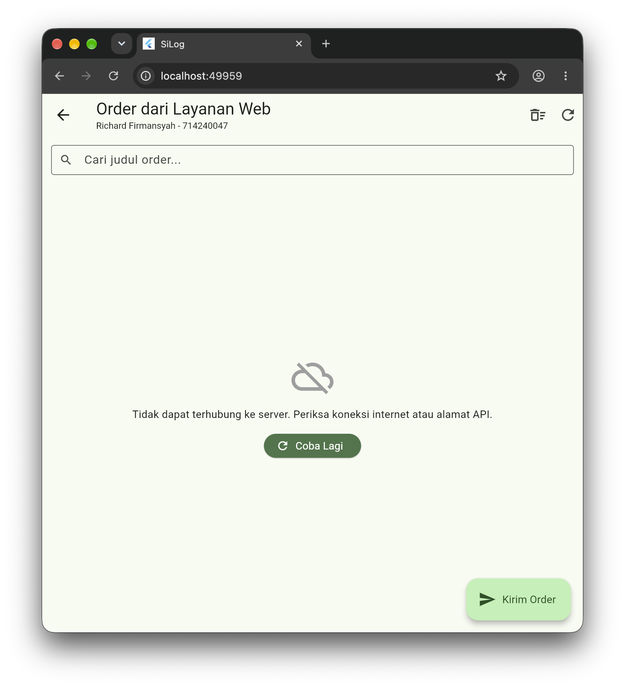

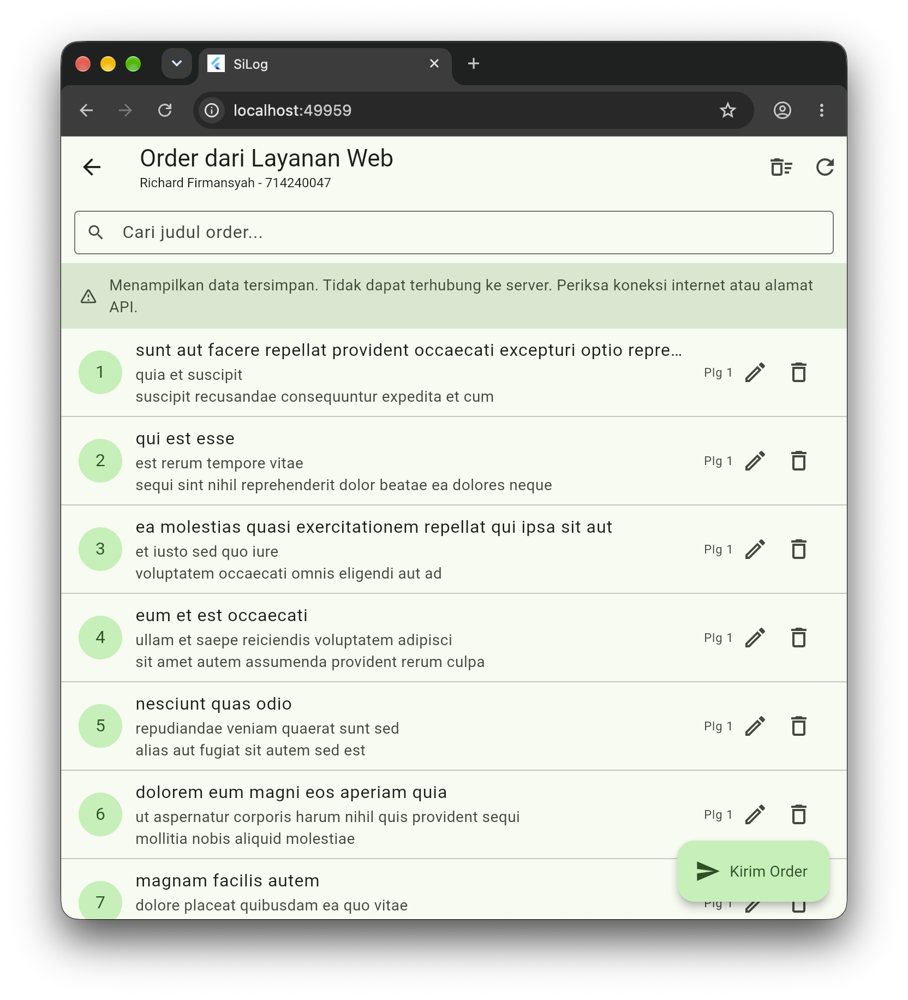

### 4.5 Penambahan Fitur Pencarian, `PUT`, `DELETE`, dan Pengujian Otomatis

1. Menambahkan kolom pencarian `TextField` (`Key('cariOrder')`) pada bagian atas `body` `OrderPage` untuk menyaring daftar berdasarkan kata kunci pada `judul` secara *real-time* di sisi klien (*case-insensitive*), disertai tombol clear dan pesan `'Tidak ada order yang cocok dengan pencarian'` apabila tidak ada data yang sesuai.
2. Menambahkan metode `perbaruiOrder(Order order)` (`PUT $_basis/posts/${order.id}`) dan `hapusOrder(int id)` (`DELETE $_basis/posts/$id`) pada `OrderApi`, lengkap dengan pemetaan kode status `200`/`204`, `404`, `>=500`, status lainnya, serta pencatatan `debugPrint`.
3. Menambahkan tombol aksi edit (`Icons.edit_outlined`) yang membuka dialog `_DialogEditOrder` dan tombol hapus (`Icons.delete_outline`) pada setiap baris `ListTile` di `OrderPage`, dengan pembaruan umpan balik `SnackBar` menggunakan `hideCurrentSnackBar()` terlebih dahulu.
4. Melengkapi berkas `test/modul09_order_api_test.dart` menggunakan `MockClient` dan `newDatabaseFactoryMemory()`, lalu menjalankan `flutter analyze` dan `flutter test` hingga seluruh pengujian lulus.

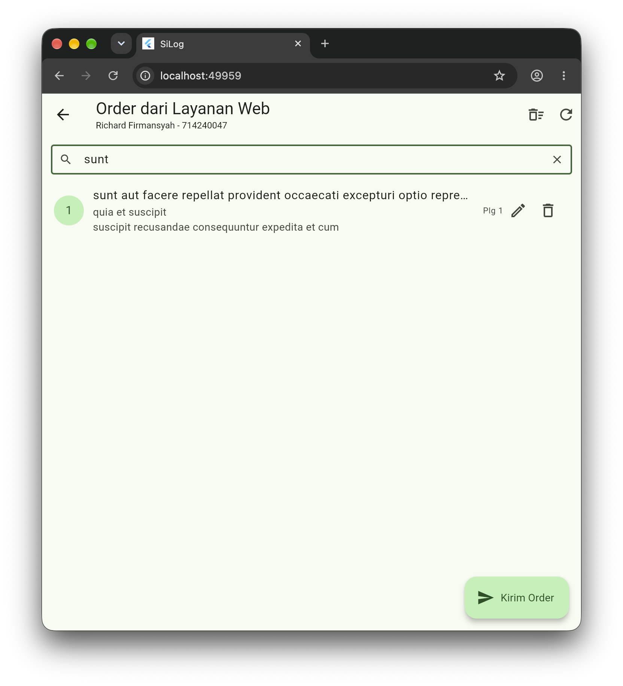

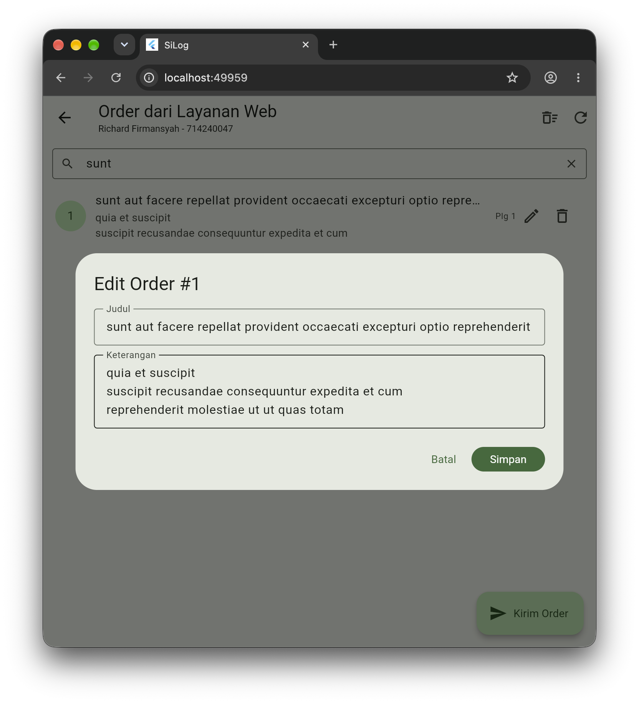

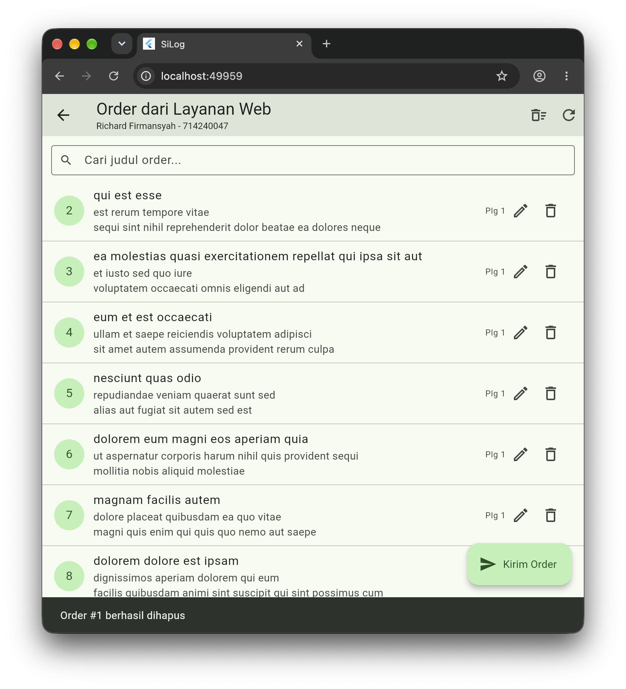

---

## 5. Kode Program

### 5.1 `lib/model/order.dart`

Berkas ini mendefinisikan struktur data `Order` beserta fungsi konversi dari JSON API JSONPlaceholder (`userId`, `title`, `body`) menuju properti berbahasa Indonesia di aplikasi dan sebaliknya.

```dart
class Order {
  final int? id;
  final int idPelanggan;
  final String judul;
  final String keterangan;

  const Order({
    this.id,
    required this.idPelanggan,
    required this.judul,
    required this.keterangan,
  });

  factory Order.fromJson(Map<String, dynamic> json) => Order(
    id: (json['id'] as num?)?.toInt(),
    idPelanggan: (json['userId'] as num?)?.toInt() ?? 0,
    judul: (json['title'] as String?) ?? '(tanpa judul)',
    keterangan: (json['body'] as String?) ?? '',
  );

  Map<String, dynamic> toJson() => {
    if (id != null) 'id': id,
    'userId': idPelanggan,
    'title': judul,
    'body': keterangan,
  };

  @override
  String toString() => 'Order(id: $id, idPelanggan: $idPelanggan, judul: $judul)';
}
```

### 5.2 `lib/data/order_api.dart`

Berkas ini membungkus seluruh transaksi HTTP (`GET`, `POST`, `PUT`, `DELETE`) terhadap server layanan web dan menerjemahkan kegagalan jaringan maupun respons HTTP non-sukses menjadi pengecualian `GagalApi`.

```dart
import 'dart:async';
import 'dart:convert';

import 'package:flutter/foundation.dart' show debugPrint;
import 'package:http/http.dart' as http;

import '../model/order.dart';

class GagalApi implements Exception {
  final String pesan;
  final int? kode;

  const GagalApi(this.pesan, {this.kode});

  @override
  String toString() => kode == null ? pesan : '$pesan (kode $kode)';
}

class OrderApi {
  static const _basis = 'https://jsonplaceholder.typicode.com';
  static const _batasWaktu = Duration(seconds: 12);

  final http.Client _client;

  OrderApi({http.Client? client}) : _client = client ?? http.Client();

  Future<T> _jalankan<T>(Future<T> Function() aksi) async {
    try {
      return await aksi();
    } on GagalApi {
      rethrow;
    } on TimeoutException {
      throw const GagalApi(
        'Waktu koneksi ke server habis. Silakan periksa jaringan Anda dan coba lagi.',
      );
    } on http.ClientException {
      throw const GagalApi(
        'Tidak dapat terhubung ke server. Periksa koneksi internet atau alamat API.',
      );
    } on FormatException {
      throw const GagalApi('Format data dari server tidak valid.');
    }
  }

  Future<List<Order>> ambilDaftar({int limit = 10}) => _jalankan(() async {
    final uri = Uri.parse('$_basis/posts').replace(
      queryParameters: {'_limit': '$limit'},
    );
    final res = await _client
        .get(uri, headers: const {'Accept': 'application/json'})
        .timeout(_batasWaktu);

    if (res.statusCode != 200) {
      throw GagalApi(
        'Gagal mengambil daftar order dari server.',
        kode: res.statusCode,
      );
    }

    final decoded = jsonDecode(res.body);
    if (decoded is! List) {
      throw const FormatException(
        'Respons daftar order bukan berupa list JSON.',
      );
    }

    return decoded.map((item) {
      if (item is! Map<String, dynamic>) {
        throw const FormatException('Format item order tidak valid.');
      }
      return Order.fromJson(item);
    }).toList();
  });

  Future<Order> kirimOrder(Order order) => _jalankan(() async {
    final uri = Uri.parse('$_basis/posts');
    final res = await _client
        .post(
          uri,
          headers: const {
            'Content-Type': 'application/json; charset=UTF-8',
            'Accept': 'application/json',
          },
          body: jsonEncode(order.toJson()),
        )
        .timeout(_batasWaktu);

    if (res.statusCode != 201 && res.statusCode != 200) {
      debugPrint('OrderApi.kirimOrder: statusCode=${res.statusCode}, id=null');
      throw GagalApi(
        'Gagal mengirim order ke server.',
        kode: res.statusCode,
      );
    }

    final decoded = jsonDecode(res.body);
    if (decoded is! Map<String, dynamic>) {
      throw const FormatException(
        'Respons kirim order bukan berupa objek JSON.',
      );
    }

    final hasil = Order.fromJson(decoded);
    debugPrint(
      'OrderApi.kirimOrder: statusCode=${res.statusCode}, id=${hasil.id}',
    );
    return hasil;
  });

  Future<Order> perbaruiOrder(Order order) => _jalankan(() async {
    if (order.id == null) {
      throw const GagalApi('ID order tidak boleh kosong untuk pembaruan.');
    }
    final uri = Uri.parse('$_basis/posts/${order.id}');
    final res = await _client
        .put(
          uri,
          headers: const {
            'Content-Type': 'application/json; charset=UTF-8',
            'Accept': 'application/json',
          },
          body: jsonEncode(order.toJson()),
        )
        .timeout(_batasWaktu);

    if (res.statusCode == 200) {
      final decoded = jsonDecode(res.body);
      if (decoded is! Map<String, dynamic>) {
        throw const FormatException(
          'Respons pembaruan order bukan berupa objek JSON.',
        );
      }
      final hasil = Order.fromJson(decoded);
      debugPrint(
        'OrderApi.perbaruiOrder: statusCode=${res.statusCode}, id=${hasil.id}',
      );
      return hasil;
    }

    debugPrint(
      'OrderApi.perbaruiOrder: statusCode=${res.statusCode}, id=${order.id}',
    );
    if (res.statusCode == 404) {
      throw GagalApi(
        'Order tidak ditemukan di server.',
        kode: res.statusCode,
      );
    }
    if (res.statusCode >= 500) {
      throw GagalApi(
        'Terjadi kesalahan pada server saat memperbarui order.',
        kode: res.statusCode,
      );
    }
    throw GagalApi(
      'Gagal memperbarui order di server.',
      kode: res.statusCode,
    );
  });

  Future<void> hapusOrder(int id) => _jalankan(() async {
    final uri = Uri.parse('$_basis/posts/$id');
    final res = await _client
        .delete(uri, headers: const {'Accept': 'application/json'})
        .timeout(_batasWaktu);

    debugPrint('OrderApi.hapusOrder: statusCode=${res.statusCode}, id=$id');
    if (res.statusCode == 200 || res.statusCode == 204) {
      return;
    }
    if (res.statusCode == 404) {
      throw GagalApi(
        'Order yang akan dihapus tidak ditemukan di server.',
        kode: res.statusCode,
      );
    }
    if (res.statusCode >= 500) {
      throw GagalApi(
        'Terjadi kesalahan pada server saat menghapus order.',
        kode: res.statusCode,
      );
    }
    throw GagalApi(
      'Gagal menghapus order di server.',
      kode: res.statusCode,
    );
  });

  void tutup() => _client.close();
}
```

### 5.3 `lib/data/order_cache.dart`

Berkas ini mengelola penyimpanan lokal salinan `Order` pada store `order_cache` di `silog.db`, kompatibel untuk Flutter Web (`databaseFactoryWeb`), desktop/mobile (`databaseFactoryIo`), serta basis data memori saat pengujian unit.

```dart
import 'package:flutter/foundation.dart' show kIsWeb, visibleForTesting;
import 'package:path_provider/path_provider.dart';
import 'package:sembast/sembast_io.dart';
import 'package:sembast_web/sembast_web.dart';

import '../model/order.dart';

class OrderCache {
  static final OrderCache instance = OrderCache._();
  OrderCache._();

  @visibleForTesting
  OrderCache.denganDatabase(Database db) : _db = db;

  Database? _db;
  final _store = intMapStoreFactory.store('order_cache');

  Future<Database> get _database async {
    if (_db != null) return _db!;
    if (kIsWeb) {
      _db = await databaseFactoryWeb.openDatabase('silog.db');
    } else {
      final dir = await getApplicationDocumentsDirectory();
      _db = await databaseFactoryIo.openDatabase('${dir.path}/silog.db');
    }
    return _db!;
  }

  Future<void> simpanSemua(List<Order> daftar) async {
    final db = await _database;
    await db.transaction((txn) async {
      await _store.delete(txn);
      for (final order in daftar) {
        await _store.add(txn, order.toJson());
      }
    });
  }

  Future<List<Order>> ambilSemua() async {
    final db = await _database;
    final rekaman = await _store.find(db);
    return rekaman
        .map((r) => Order.fromJson(Map<String, dynamic>.from(r.value)))
        .toList();
  }

  Future<void> hapusSemua() async {
    final db = await _database;
    await _store.delete(db);
  }
}
```

### 5.4 `lib/tampilan/order_page.dart`

Berkas ini merupakan halaman utama modul layanan web yang menyatukan `FutureBuilder`, mekanisme fallback cache `_ambilDenganCadangan()`, kolom pencarian judul, aksi `POST`, `PUT` (melalui dialog `_DialogEditOrder`), `DELETE`, serta tombol penghapusan cache.

```dart
import 'package:flutter/material.dart';

import '../data/order_api.dart';
import '../data/order_cache.dart';
import '../model/order.dart';

class OrderPage extends StatefulWidget {
  final OrderApi? api;
  final OrderCache? cache;

  const OrderPage({super.key, this.api, this.cache});

  @override
  State<OrderPage> createState() => _OrderPageState();
}

class _OrderPageState extends State<OrderPage> {
  late final OrderApi _api;
  late final OrderCache _cache;
  late Future<List<Order>> _future;
  final TextEditingController _cariC = TextEditingController();
  String _kataKunci = '';
  bool _mengirim = false;
  String? _peringatan;

  @override
  void initState() {
    super.initState();
    _api = widget.api ?? OrderApi();
    _cache = widget.cache ?? OrderCache.instance;
    _future = _ambilDenganCadangan();
  }

  @override
  void dispose() {
    _cariC.dispose();
    _api.tutup();
    super.dispose();
  }

  Future<List<Order>> _ambilDenganCadangan() async {
    try {
      final segar = await _api.ambilDaftar();
      await _cache.simpanSemua(segar);
      _peringatan = null;
      return segar;
    } on GagalApi catch (e) {
      final lokal = await _cache.ambilSemua();
      if (lokal.isNotEmpty) {
        _peringatan = 'Menampilkan data tersimpan. $e';
        return lokal;
      }
      _peringatan = null;
      rethrow;
    }
  }

  Future<void> _muatUlang() async {
    final baru = _ambilDenganCadangan();
    setState(() {
      _future = baru;
    });
    try {
      await baru;
    } catch (_) {}
  }

  void _tampilPesan(String pesan) {
    if (!mounted) return;
    ScaffoldMessenger.of(context)
      ..hideCurrentSnackBar()
      ..showSnackBar(SnackBar(content: Text(pesan)));
  }

  Future<void> _hapusCache() async {
    await _cache.hapusSemua();
    _tampilPesan('Cache order berhasil dihapus');
  }

  Future<void> _kirimOrderContoh() async {
    if (_mengirim) return;
    setState(() => _mengirim = true);
    try {
      final hasil = await _api.kirimOrder(
        const Order(
          idPelanggan: 7,
          judul: 'Order pengiriman Bandung Surabaya',
          keterangan: '3 koli, berat total 42 kg, layanan reguler',
        ),
      );
      _tampilPesan('Order terkirim dengan id ${hasil.id}');
    } catch (e) {
      _tampilPesan('Gagal: $e');
    } finally {
      if (mounted) {
        setState(() => _mengirim = false);
      }
    }
  }

  Future<void> _editOrder(Order order) async {
    final hasilForm = await showDialog<Order>(
      context: context,
      builder: (_) => _DialogEditOrder(order: order),
    );
    if (hasilForm == null || !mounted) return;
    try {
      final hasil = await _api.perbaruiOrder(hasilForm);
      _tampilPesan('Order #${hasil.id} berhasil diperbarui');
    } catch (e) {
      _tampilPesan('Gagal: $e');
    }
  }

  Future<void> _hapusOrder(Order order) async {
    if (order.id == null) return;
    try {
      await _api.hapusOrder(order.id!);
      _tampilPesan('Order #${order.id} berhasil dihapus');
    } catch (e) {
      _tampilPesan('Gagal: $e');
    }
  }

  @override
  Widget build(BuildContext context) {
    return Scaffold(
      appBar: AppBar(
        centerTitle: false,
        title: const Column(
          crossAxisAlignment: CrossAxisAlignment.start,
          mainAxisSize: MainAxisSize.min,
          children: [
            Text('Order dari Layanan Web'),
            Text(
              'Richard Firmansyah - 714240047',
              style: TextStyle(fontSize: 12),
            ),
          ],
        ),
        actions: [
          IconButton(
            tooltip: 'Hapus Cache',
            icon: const Icon(Icons.delete_sweep_outlined),
            onPressed: _hapusCache,
          ),
          IconButton(
            tooltip: 'Muat ulang',
            icon: const Icon(Icons.refresh),
            onPressed: _muatUlang,
          ),
        ],
      ),
      body: Column(
        children: [
          Padding(
            padding: const EdgeInsets.fromLTRB(12, 12, 12, 8),
            child: TextField(
              key: const Key('cariOrder'),
              controller: _cariC,
              decoration: InputDecoration(
                hintText: 'Cari judul order...',
                prefixIcon: const Icon(Icons.search),
                suffixIcon: _kataKunci.isEmpty
                    ? null
                    : IconButton(
                        tooltip: 'Bersihkan pencarian',
                        icon: const Icon(Icons.clear),
                        onPressed: () {
                          _cariC.clear();
                          setState(() => _kataKunci = '');
                        },
                      ),
                border: const OutlineInputBorder(),
                isDense: true,
              ),
              onChanged: (nilai) => setState(() => _kataKunci = nilai),
            ),
          ),
          Expanded(
            child: FutureBuilder<List<Order>>(
              future: _future,
              builder: (context, snapshot) {
                if (snapshot.connectionState == ConnectionState.waiting) {
                  return const Center(child: CircularProgressIndicator());
                }
                if (snapshot.hasError) {
                  return Center(
                    child: Padding(
                      padding: const EdgeInsets.all(24),
                      child: Column(
                        mainAxisSize: MainAxisSize.min,
                        children: [
                          const Icon(
                            Icons.cloud_off,
                            size: 56,
                            color: Colors.grey,
                          ),
                          const SizedBox(height: 12),
                          Text('${snapshot.error}', textAlign: TextAlign.center),
                          const SizedBox(height: 16),
                          FilledButton.icon(
                            onPressed: _muatUlang,
                            icon: const Icon(Icons.refresh),
                            label: const Text('Coba Lagi'),
                          ),
                        ],
                      ),
                    ),
                  );
                }

                final daftar = snapshot.data ?? [];
                if (daftar.isEmpty) {
                  return const Center(
                    child: Text('Belum ada order yang tercatat'),
                  );
                }

                final kueri = _kataKunci.trim().toLowerCase();
                final tersaring = kueri.isEmpty
                    ? daftar
                    : daftar
                        .where((o) => o.judul.toLowerCase().contains(kueri))
                        .toList();

                return Column(
                  children: [
                    if (_peringatan != null)
                      Material(
                        color: Theme.of(context).colorScheme.secondaryContainer,
                        child: Padding(
                          padding: const EdgeInsets.symmetric(
                            horizontal: 16,
                            vertical: 10,
                          ),
                          child: Row(
                            children: [
                              Icon(
                                Icons.warning_amber_rounded,
                                size: 18,
                                color: Theme.of(
                                  context,
                                ).colorScheme.onSecondaryContainer,
                              ),
                              const SizedBox(width: 10),
                              Expanded(
                                child: Text(
                                  _peringatan!,
                                  style: TextStyle(
                                    color: Theme.of(
                                      context,
                                    ).colorScheme.onSecondaryContainer,
                                  ),
                                ),
                              ),
                            ],
                          ),
                        ),
                      ),
                    Expanded(
                      child: tersaring.isEmpty
                          ? const Center(
                              child: Text(
                                'Tidak ada order yang cocok dengan pencarian',
                              ),
                            )
                          : RefreshIndicator(
                              onRefresh: _muatUlang,
                              child: ListView.separated(
                                physics: const AlwaysScrollableScrollPhysics(),
                                itemCount: tersaring.length,
                                separatorBuilder: (_, _) =>
                                    const Divider(height: 1),
                                itemBuilder: (context, i) {
                                  final o = tersaring[i];
                                  return ListTile(
                                    leading: CircleAvatar(
                                      child: Text('${o.id ?? '-'}'),
                                    ),
                                    title: Text(
                                      o.judul,
                                      maxLines: 1,
                                      overflow: TextOverflow.ellipsis,
                                    ),
                                    subtitle: Text(
                                      o.keterangan,
                                      maxLines: 2,
                                      overflow: TextOverflow.ellipsis,
                                    ),
                                    trailing: Row(
                                      mainAxisSize: MainAxisSize.min,
                                      children: [
                                        Text('Plg ${o.idPelanggan}'),
                                        IconButton(
                                          tooltip: 'Edit order',
                                          icon: const Icon(Icons.edit_outlined),
                                          onPressed: o.id == null
                                              ? null
                                              : () => _editOrder(o),
                                        ),
                                        IconButton(
                                          tooltip: 'Hapus order',
                                          icon: const Icon(
                                            Icons.delete_outline,
                                          ),
                                          onPressed: o.id == null
                                              ? null
                                              : () => _hapusOrder(o),
                                        ),
                                      ],
                                    ),
                                  );
                                },
                              ),
                            ),
                    ),
                  ],
                );
              },
            ),
          ),
        ],
      ),
      floatingActionButton: FloatingActionButton.extended(
        onPressed: _mengirim ? null : _kirimOrderContoh,
        icon: const Icon(Icons.send),
        label: const Text('Kirim Order'),
      ),
    );
  }
}

class _DialogEditOrder extends StatefulWidget {
  final Order order;

  const _DialogEditOrder({required this.order});

  @override
  State<_DialogEditOrder> createState() => _DialogEditOrderState();
}

class _DialogEditOrderState extends State<_DialogEditOrder> {
  late final TextEditingController _judulC;
  late final TextEditingController _ketC;

  @override
  void initState() {
    super.initState();
    _judulC = TextEditingController(text: widget.order.judul);
    _ketC = TextEditingController(text: widget.order.keterangan);
  }

  @override
  void dispose() {
    _judulC.dispose();
    _ketC.dispose();
    super.dispose();
  }

  @override
  Widget build(BuildContext context) {
    return AlertDialog(
      title: Text('Edit Order #${widget.order.id}'),
      content: Column(
        mainAxisSize: MainAxisSize.min,
        children: [
          TextField(
            key: const Key('editJudulOrder'),
            controller: _judulC,
            decoration: const InputDecoration(
              labelText: 'Judul',
              border: OutlineInputBorder(),
            ),
          ),
          const SizedBox(height: 12),
          TextField(
            key: const Key('editKeteranganOrder'),
            controller: _ketC,
            maxLines: 3,
            decoration: const InputDecoration(
              labelText: 'Keterangan',
              border: OutlineInputBorder(),
            ),
          ),
        ],
      ),
      actions: [
        TextButton(
          onPressed: () => Navigator.pop(context),
          child: const Text('Batal'),
        ),
        FilledButton(
          onPressed: () {
            final judulBaru = _judulC.text.trim();
            if (judulBaru.isEmpty) return;
            Navigator.pop(
              context,
              Order(
                id: widget.order.id,
                idPelanggan: widget.order.idPelanggan,
                judul: judulBaru,
                keterangan: _ketC.text.trim(),
              ),
            );
          },
          child: const Text('Simpan'),
        ),
      ],
    );
  }
}
```

### 5.5 Potongan Navigasi di `lib/tampilan/daftar_pengiriman_page.dart`

Penambahan impor halaman order dan tombol aksi di `AppBar` `DaftarPengirimanPage` agar pengguna dapat berpindah langsung ke `OrderPage`.

```dart
import 'order_page.dart';
```

```dart
          IconButton(
            tooltip: 'Order Layanan Web',
            icon: const Icon(Icons.cloud_download_outlined),
            onPressed: () => Navigator.push(
              context,
              MaterialPageRoute(builder: (_) => const OrderPage()),
            ),
          ),
```

---

## 6. Hasil Eksekusi dan Analisis

### 6.1 Alur Eksekusi Normal (`GET`, `POST`, `PUT`, `DELETE`)

Saat `OrderPage` dibuka, `initState()` menjalankan `_ambilDenganCadangan()` yang memanggil `OrderApi.ambilDaftar(limit: 10)`. Selama permintaan berlangsung, `FutureBuilder` menampilkan `CircularProgressIndicator`. Ketika server mengembalikan HTTP `200`, data JSON dipetakan menjadi `List<Order>`, disimpan ke cache Sembast, dan ditampilkan dalam `ListView.separated` yang mendukung *pull-to-refresh* melalui `RefreshIndicator`. Aksi `Kirim Order` (`POST`), `Edit order` (`PUT`), dan `Hapus order` (`DELETE`) masing-masing mencetak `statusCode` serta `id` ke Debug Console melalui `debugPrint` dan menampilkan umpan balik ringkas via `SnackBar`.

### 6.2 Penyesuaian Penanganan Kesalahan untuk Flutter Web / Chrome

Pada target kompilasi web (`flutter run -d chrome`), pustaka `dart:io` beserta kelas `SocketException` tidak tersedia karena peramban menjalankan kode Dart yang dikompilasi ke JavaScript/WebAssembly di atas API `BrowserClient` (`XMLHttpRequest` / `Fetch`). Oleh karena itu, `OrderApi` tidak mengimpor `dart:io` dan menggantinya dengan blok penangkap `http.ClientException`, `TimeoutException`, dan `FormatException` pada pembantu `_jalankan()`. Dengan pendekatan ini, kondisi jaringan terputus, kegagalan resolusi DNS, atau kesalahan alamat API di Chrome selalu tertangkap sebagai `http.ClientException` dan diterjemahkan menjadi objek `GagalApi` dengan pesan berbahasa Indonesia yang informatif, bukan galat mentah bawaan peramban.

### 6.3 Perilaku JSONPlaceholder sebagai *Fake REST API*

Layanan `https://jsonplaceholder.typicode.com` berfungsi sebagai *fake REST API* untuk prototipe dan pembelajaran. Permintaan `POST /posts` mengembalikan status `201` dengan `id` simulasi (`101`), `PUT /posts/{id}` mengembalikan status `200` dengan payload yang dikirim, dan `DELETE /posts/{id}` mengembalikan status `200`. Namun, perubahan tersebut tidak disimpan secara persisten di basis data server, sehingga pemanggilan ulang `GET /posts?_limit=10` tetap mengembalikan sepuluh data awal yang sama.

### 6.4 Mekanisme Fallback Cache Lokal Sembast

Integrasi `OrderCache` di atas `sembast` dan `sembast_web` menyimpan salinan daftar order terbaru ke dalam IndexedDB Chrome (`silog.db`, store `order_cache`). Apabila koneksi terputus setelah pengguna pernah memuat data, `OrderPage` tetap menampilkan daftar order tersimpan disertai banner peringatan berwarna `secondaryContainer` bertuliskan `'Menampilkan data tersimpan. $e'`. Tombol `'Hapus Cache'` di `AppBar` memungkinkan pengosongan store secara instan agar skenario gagal total tanpa cadangan (`Icons.cloud_off` dan tombol `'Coba Lagi'`) dapat diverifikasi secara langsung saat luring.

### 6.5 Ringkasan Hasil Verifikasi Otomatis

1. **`flutter analyze`**: berjalan bersih dengan hasil `No issues found!`.
2. **`flutter test`**: seluruh **28 dari 28** skenario pengujian pada proyek lulus tanpa kegagalan, mencakup:
   - `test/modul09_order_api_test.dart`: serialisasi `Order`, `ambilDaftar` (`_limit`), `kirimOrder` (`POST`), `perbaruiOrder` (`PUT` sukses dan status `404`/`500`/`400`/timeout/offline/JSON rusak/tanpa ID), `hapusOrder` (`DELETE` `200`/`204` dan status `404`/`500`/`403`/timeout/offline), operasi `OrderCache` dengan `newDatabaseFactoryMemory()`, fallback cache offline dan `Hapus Cache` di `OrderPage`, pencarian judul *real-time*, aksi dialog edit dan hapus, serta keberadaan tombol navigasi di `DaftarPengirimanPage`.
   - Berkas pengujian modul sebelumnya (`modul04_models_test.dart`, `modul05_layanan_test.dart`, `modul08_penyimpanan_test.dart`, dan `widget_test.dart`) tetap lulus seluruhnya.

---

## 7. Jawaban Tugas Praktikum

### 7.1 Tugas Praktikum 1 — Pencarian Order Berdasarkan Kata Kunci Judul (Client-Side)

Fitur pencarian diterapkan langsung pada `OrderPage` menggunakan `TextField` (`key: const Key('cariOrder')`) di bagian atas `body`. Setiap perubahan teks memanggil `setState()` untuk memperbarui `_kataKunci`. Di dalam `FutureBuilder`, daftar hasil (`daftar`) disaring di sisi klien tanpa memanggil ulang API melalui ekspresi `daftar.where((o) => o.judul.toLowerCase().contains(kueri)).toList()` sehingga pencocokan bersifat *case-insensitive* dan langsung merespons ketikan pengguna. Tersedia tombol ikon hapus pencarian (`Icons.clear`, tooltip `'Bersihkan pencarian'`) saat kolom tidak kosong. Apabila daftar asli tidak kosong tetapi hasil penyaringan kosong, aplikasi menampilkan pesan `'Tidak ada order yang cocok dengan pencarian'`.

### 7.2 Tugas Praktikum 2 — Metode `perbaruiOrder` (PUT) dan `hapusOrder` (DELETE)

1. **`OrderApi.perbaruiOrder(Order order)`**: memvalidasi bahwa `order.id != null`, lalu mengirim permintaan `PUT` ke `$_basis/posts/${order.id}` dengan header `Content-Type: application/json; charset=UTF-8`, badan `jsonEncode(order.toJson())`, serta batas waktu 12 detik. Status `200` mengembalikan objek `Order.fromJson(decoded)` disertai `debugPrint` status dan `id`. Status `404`, `>=500`, status non-sukses lainnya, `TimeoutException`, `http.ClientException`, dan `FormatException` diterjemahkan menjadi `GagalApi` yang informatif.
2. **`OrderApi.hapusOrder(int id)`**: mengirim permintaan `DELETE` ke `$_basis/posts/$id` dengan batas waktu 12 detik dan mencatat `statusCode` serta `id` melalui `debugPrint`. Status `200` atau `204` dianggap berhasil, sedangkan status `404`, `>=500`, status lain, `TimeoutException`, dan `http.ClientException` melempar `GagalApi`.
3. **Integrasi Antarmuka `OrderPage`**: setiap `ListTile` dilengkapi tombol `Icons.edit_outlined` (membuka `_DialogEditOrder` lalu memanggil `_api.perbaruiOrder` dan menampilkan `SnackBar('Order #${hasil.id} berhasil diperbarui')`) serta tombol `Icons.delete_outline` (memanggil `_api.hapusOrder(order.id!)` dan menampilkan `SnackBar('Order #${order.id} berhasil dihapus')`).

### 7.3 Tabel Endpoint dan Perilaku Aplikasi

| Alamat Endpoint | Metode HTTP | Contoh Badan Permintaan | Kode Status | Perilaku Aplikasi |
| --- | --- | --- | --- | --- |
| `https://jsonplaceholder.typicode.com/posts?_limit=10` | `GET` | `-` (tidak ada badan; query `_limit=10`) | `200 OK` | Daftar 10 `Order` ditampilkan pada `ListView.separated`, banner peringatan disembunyikan, dan data disimpan ke cache Sembast (`order_cache`). |
| `https://jsonplaceholder.typicode.com/posts` | `POST` | `{"userId":7,"title":"Order pengiriman Bandung Surabaya","body":"3 koli, berat total 42 kg, layanan reguler"}` | `201 Created` | `debugPrint` mencatat `statusCode=201, id=101`; muncul `SnackBar` bertuliskan `'Order terkirim dengan id 101'`. |
| `https://jsonplaceholder.typicode.com/posts/1` | `PUT` | `{"id":1,"userId":3,"title":"Judul Baru","body":"Keterangan Baru"}` | `200 OK` | `debugPrint` mencatat `statusCode=200, id=1`; muncul `SnackBar` bertuliskan `'Order #1 berhasil diperbarui'`. |
| `https://jsonplaceholder.typicode.com/posts/1` | `DELETE` | `-` | `200 OK` / `204 No Content` | `debugPrint` mencatat `statusCode=200, id=1`; muncul `SnackBar` bertuliskan `'Order #1 berhasil dihapus'`. |
| `https://jsonplaceholder.typicode.com/post-salah` (atau `PUT`/`DELETE` `/posts/99999`) | `GET` / `PUT` / `DELETE` | `-` (atau JSON `Order` pada `PUT`) | `404 Not Found` | `OrderApi` melempar `GagalApi` dengan `kode: 404`; pada `GET` menggunakan cache jika tersedia, atau menampilkan ikon `cloud_off` + `'Coba Lagi'` jika cache kosong; pada `PUT`/`DELETE` menampilkan `SnackBar('Gagal: ... (kode 404)')`. |
| `https://jsonplaceholder.typicode.com/posts?_limit=10` (koneksi terputus / luring) | `GET` | `-` | `-` (`ClientException` / `TimeoutException`) | `OrderApi` melempar `GagalApi` tanpa kode status; jika cache Sembast berisi data, tampil daftar tersimpan + banner `'Menampilkan data tersimpan. ...'`; jika cache kosong, tampil ikon `cloud_off`, pesan galat, dan tombol `'Coba Lagi'`. |

---

## 8. Kesimpulan dan Kendala

### 8.1 Kesimpulan

Integrasi layanan web pada aplikasi SiLog telah berhasil diimplementasikan secara menyeluruh pada cabang `praktikum/modul-09`. Paket `http` terhubung dengan model `Order`, kelas layanan `OrderApi` (`GET`, `POST`, `PUT`, `DELETE`), halaman `OrderPage`, serta navigasi dari `DaftarPengirimanPage`. Penanganan kesalahan dirancang kompatibel untuk Google Chrome tanpa bergantung pada `dart:io`, sedangkan kombinasi dengan `OrderCache` berbasis `sembast`/`sembast_web` menjaga ketersediaan data ketika perangkat berada dalam kondisi luring. Seluruh fitur telah terverifikasi bersih oleh `flutter analyze` dan lulus 28 pengujian pada `flutter test`.

### 8.2 Kendala dan Penyelesaian

1. **Kompatibilitas Pengecualian Jaringan di Flutter Web**: penggunaan `SocketException` dari `dart:io` tidak dapat berjalan pada target Chrome. Masalah diselesaikan dengan menangkap `http.ClientException`, `TimeoutException`, dan `FormatException` secara langsung pada `OrderApi`.
2. **Penutupan Callback `setState` yang Mengembalikan `Future`**: penggunaan fungsi panah `setState(() => _future = baru)` sempat memicu asersi kerangka kerja Flutter saat pengujian widget karena mengembalikan nilai `Future`. Masalah diselesaikan dengan mengubahnya menjadi blok `setState(() { _future = baru; });`.
3. **Antrean `SnackBar` pada Pengujian Aksi Beruntun**: pemanggilan `showSnackBar` berturut-turut saat edit dan hapus membuat pesan kedua menunggu durasi `SnackBar` pertama habis. Masalah diselesaikan dengan menambahkan pembantu `_tampilPesan()` yang memanggil `hideCurrentSnackBar()` sebelum menampilkan `SnackBar` baru.
4. **Siklus Hidup `TextEditingController` pada Dialog Edit**: menempatkan controller langsung pada metode pemanggil `showDialog` berisiko menimbulkan galat pemakaian controller setelah `dispose` saat animasi dialog menutup. Masalah diselesaikan dengan memisahkan dialog ke `StatefulWidget` tersendiri (`_DialogEditOrder`).
5. **Sifat *Fake REST API* JSONPlaceholder**: hasil `POST`, `PUT`, dan `DELETE` tidak memutasi daftar `GET` di server, sehingga verifikasi keberhasilan perubahan difokuskan pada `statusCode`, `debugPrint`, `SnackBar`, serta `MockClient` pada unit test.

---

## 9. Tautan Repositori dan Bukti Riwayat Commit

- **Tautan Repositori GitHub:** `https://github.com/copetpasarsenin/silog-714240047/tree/praktikum/modul-09`
- **Riwayat Commit (`git log --oneline -n 6`):**

```text
7f39bbf (HEAD -> praktikum/modul-09) docs(modul-09): tambah draf jurnal praktikum modul 09
b8d78a2 feat(modul-09): tambah pencarian judul, PUT, DELETE, dan unit test
a116f55 feat(modul-09): integrasi cache lokal Sembast untuk fallback offline
287b156 feat(modul-09): tambah OrderPage dan navigasi ke OrderPage
9818a04 feat(modul-09): setup http, model Order, dan OrderApi dasar
3cd3b90 (origin/praktikum/modul-08, praktikum/modul-08) docs(modul-08): tambahkan bukti commit pada jurnal dan PDF
```

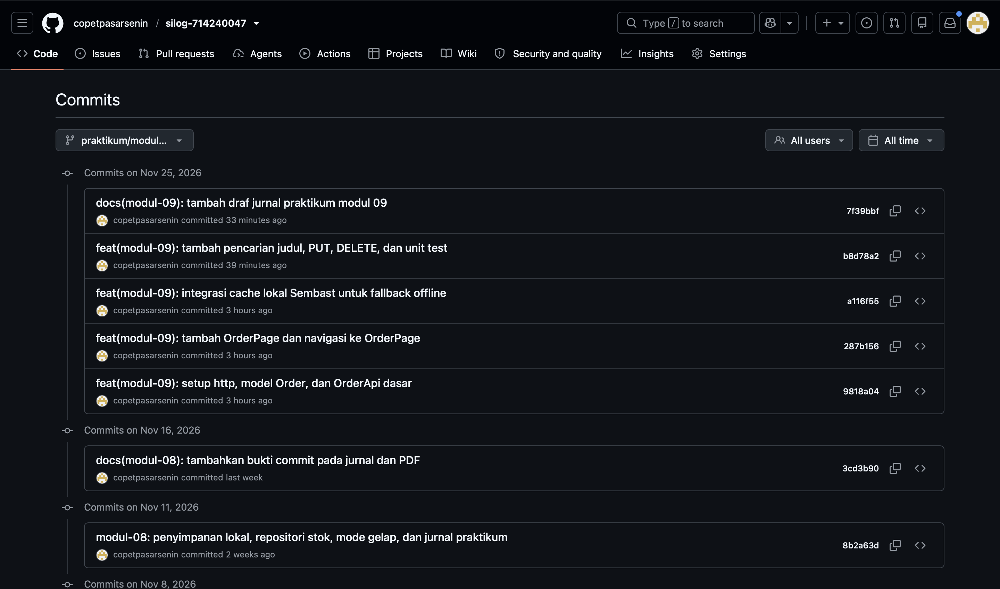
